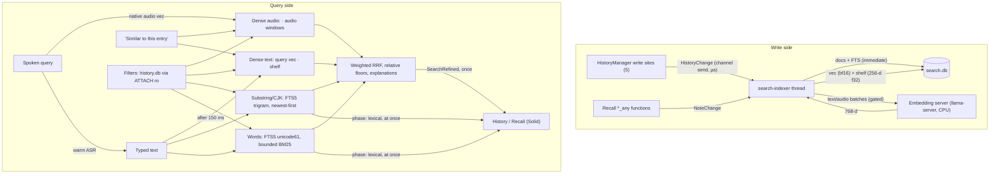
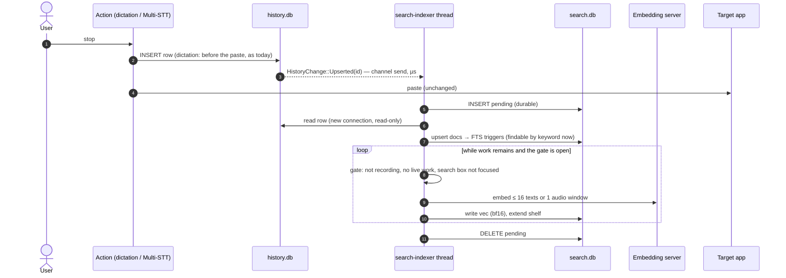

# FreeSpeech Search Architecture: Hybrid Retrieval over History, Audio and Recall

> **Status:** proposal, revision 4 (2026-11-19). Nothing in FreeSpeech is implemented. The model
> is downloaded, and it has been run on this machine.
>
> **Start here (next agent).** The phase-2 spike is **done** and its gate is met. The model
> files, a test harness and every result are next to the Gemma 4 brain model:
> `C:\Users\Z\Downloads\PROJECTS\Llama.cpp\model\embeddinggemma-2\` (Appendix B for the
> results, Appendix C for the files). Phase 0 (§15) can start now.
>
> Revision 4 ran EmbeddingGemma 2 through the installed llama-server (b12521) on CPU and
> CUDA, against Google's float32 reference, on a 34-clip speech corpus. §0.0 lists what that
> changed. Revision 2 checked the plan against the released **EmbeddingGemma 2** (Google
> DeepMind, 2026-10-06). Revision 3 checked it against three more things:
>
> 1. **The code.** Every write site, the paste ordering, the Multi-STT history format
>    and the llama-server supervisor were traced. §13 is a file-by-file implementation
>    guide with `file:line` anchors.
> 2. **A measurement harness.** The proposed SQL was run against the exact SQLite FreeSpeech
>    bundles (rusqlite 0.40.2, SQLite 3.53.2), and the vector-shelf budgets were timed on
>    this machine. Two revision-2 SQL statements were wrong, and one latency target did
>    not hold. Appendix A has the numbers.
> 3. **The installed runtime.** `llama-server` build b12521 (version 1.0.0-dev) is already
>    in `<app data>/llama_cpp/cuda-13.5-b12521`. Its flags, its `/props` endpoint and
>    the request shapes it accepts replace revision 2's guesses (§6.2).
>
> Section 0 lists every change. Section 18 lists the sources.

---

## 0. What changed

### 0.0 Revision 4: what running the model showed (Appendix B has the numbers)

| Revision 3 said                                                  | Measured on this machine (i9-13900H, RTX 4070 Laptop 8 GB, llama.cpp b12521)                                                                                                                                                                                                                                                                    | Consequence                                                                                                                                                             |
| ---------------------------------------------------------------- | ----------------------------------------------------------------------------------------------------------------------------------------------------------------------------------------------------------------------------------------------------------------------------------------------------------------------------------------------- | ----------------------------------------------------------------------------------------------------------------------------------------------------------------------- |
| Audio parity with the reference is unmeasured by anyone          | Against `google/embeddinggemma-2` in float32 (sentence-transformers 6.3.0): Q8_0 text **≥ 0.99934** (median 0.99987, 81 texts); audio **≥ 0.99899** (median 0.99973, 34 clips ≤ 30 s); mixed text+audio ≥ 0.99902. CUDA: text ≥ 0.99868, audio ≥ 0.9989, no NaN. The server warns "audio input is in experimental stage", but the vectors match | The phase-2 gate is met on CPU and CUDA. Audio is no longer a gamble, and the `embeddinggemma.c` / LiteRT fallbacks are not needed                                      |
| 30 s windows, "the processor's default segment"                  | The reference processor **truncates** audio at 750 tokens: a 60 s clip gives the same 750 tokens as its first 30 s. llama.cpp embeds the full clip, so the two diverge (cosine 0.951 at 60 s; 0.9989 at 30 s)                                                                                                                                   | Windows must be **≤ 30 s**. That is what the model was evaluated on, and the only length at which llama.cpp matches the reference                                       |
| "About 327 s per input at most"                                  | 300 s = 7,504 tokens works. 330 s = 8,254 tokens returns HTTP 500 in 0.37 s: "input (8254 tokens) is too large to process. increase the physical batch size". Audio is 25 tokens/s plus 4                                                                                                                                                       | Over-long input fails fast and cleanly. With ≤ 30 s windows (754 tokens) the context shrinks to **2,048** (§6.2)                                                        |
| Q8_0 or UD-Q4_K_XL, decided by §16                               | UD-Q4_K_XL text parity: **min 0.98516**, median 0.99528, which fails the ≥ 0.99 gate. BF16 text is exact (≥ 0.99999). Q8_0 passes                                                                                                                                                                                                               | **Q8_0 is the default.** Q4 saves 134 MB of disk and about 30% of the time, and costs quality                                                                           |
| Audio backfill: "1.5–7 s per window", unmeasured in llama.cpp    | CPU, 4 threads: **165–220 ms per second of audio** (5.1–5.7 s per 30 s window); 8 threads 121–131 ms/s. CUDA: **4.5–8.6 ms/s** (0.14–0.22 s per window). One hour of audio: about 11 min on 4 CPU threads, about 16 s on the GPU                                                                                                                | §7.3 keeps the backfill policy, now with numbers. GPU becomes a real option (§17)                                                                                       |
| A query "waits behind one small batch"                           | A query waited **22.4 s** behind a 120 s clip and **5.0 s** behind a 30 s window, with `-np 1` **and** with `-np 2` (4.98 s): the media encode blocks the server                                                                                                                                                                                | Audio work pauses while the History page is mounted. A second slot is not a fix                                                                                         |
| Memory "to be measured"                                          | CPU text-only: 472 MB RSS idle, about 560–590 MB working. With the projector: 1,011 MB idle, about 1.26–1.29 GB after a 30 s window (2.28 GB after a 300 s input). GPU at `-c 2048`: +501 MB VRAM text-only, +1,177 MB with the projector (at `-c 8192`: +1,365 / +2,041 MB). Sleeping: **222 MB**                                              | `-c 2048`. The projector loads only while audio indexing is on. `--device none --no-op-offload` creates **no CUDA context** (the process never appears in `nvidia-smi`) |
| `--sleep-idle-seconds` unloads the model                         | Confirmed. Asleep after the timeout; RSS 1,012 → 222 MB; `/health` polls do not wake it; the next request wakes it in **1.05 s**                                                                                                                                                                                                                | The app needs no idle-stop logic of its own                                                                                                                             |
| Typed `input_audio` parts; a literal `<__media__>` fails         | Confirmed. Nested `content` + `input_audio` → 200. Flat parts → 400. `/embedding` with a literal `<__media__>` → 500 "Failed to tokenize prompt". With the `/props` marker → 200, identical vector. `input_audio.format` is ignored                                                                                                             | §6.3 as written                                                                                                                                                         |
| Guard against silently ignored media                             | `/embedding` with `image_data` holding audio returns **200 with the empty-text vector** (cosine 1.0000 to `""`). A real audio vector scores 0.653 against it                                                                                                                                                                                    | The guard (reject cosine > 0.999 to the empty vector) is necessary and has a wide margin                                                                                |
| One joint transcript+audio vector might absorb ASR errors (§7.5) | The mixed vector sits closer to the text (0.958) than to the audio (0.927). For "Kubernetes upgrade" against a transcript that says "cube netties": misheard text 0.785, audio **0.724**, mixed 0.782, correct text 0.816                                                                                                                       | Audio does **not** rescue a misheard rare term. Multi-STT candidates (lexical) stay the safety net, and the joint vector drops to a low-priority experiment             |
| "Similar content, not similar voice"                             | The same text in two voices: 0.951–0.98. Different texts, same voice: median 0.638, max 0.729. Different voice and text: about the same                                                                                                                                                                                                         | Confirmed. The model hears content, not the speaker                                                                                                                     |
| Raw recordings need VAD trimming                                 | 10 s of silence either side of a 6 s clip: cosine 0.984 to the clean clip, and the same top match, but **4.3×** the tokens (653 vs 153)                                                                                                                                                                                                         | Trimming is a **cost** fix, not a quality fix                                                                                                                           |
| Relative floors                                                  | On the corpus: matching queries z = 2.76–3.65; negative queries z = 1.29–1.65; noise and silence windows against texts z = 1.53–1.62 (max cosine 0.61–0.63). Match cosines about 0.80, negatives about 0.59                                                                                                                                     | A starting `z_min` of about 2.2 separates them here. §16 calibrates it on a real corpus                                                                                 |
| Sliding window 1024 (model card)                                 | `config.json`: `sliding_window` 512                                                                                                                                                                                                                                                                                                             | Corrected in §2.1                                                                                                                                                       |

### 0.1 Revision 3: what the code, the measurements and the runtime showed

| Revision 2 said                                                                          | What actually holds                                                                                                                                                                                                                                                                                                        | Consequence                                                                                                                                                                                                                               |
| ---------------------------------------------------------------------------------------- | -------------------------------------------------------------------------------------------------------------------------------------------------------------------------------------------------------------------------------------------------------------------------------------------------------------------------- | ----------------------------------------------------------------------------------------------------------------------------------------------------------------------------------------------------------------------------------------- |
| Each extra model's transcript is stored in `extra_models`                                | `extra_models` holds the extra **model ids** (`actions.rs:2950`). The per-model texts are in `transcription_text`: a human-readable dump followed by a machine-readable trailer, `<!--MULTI_STT_METADATA:{json}-->`, version 1, with `models[{slot, model_id, text}]`, `brain` and `final_merged_text` (`actions.rs:1420`) | Candidates are read from the trailer (§4.1). Today's search already matches candidate text, but it also matches the dump's headers, model ids, provider names and the raw brain output, so "model" or "brain" matches every Multi-STT row |
| The `pending` insert happens "after the paste is handed off"                             | `TranscribeAction` writes the history row **before** the transcription hook and the paste, inline on its async task (`actions.rs:1179`). `save_entry_full` also runs the retention cleanup, which can `VACUUM` (`history.rs:642`, `:807`). Multi-STT saves concurrently on the blocking pool (`actions.rs:2960`)           | Change notification is an in-memory channel send (microseconds, no I/O). The durable queue is written by the indexer thread (§5.3). Moving the dictation save off the paste path is an adjacent fix (phase 0b)                            |
| Every write site can enqueue                                                             | Retention cleanup deletes rows with **no event** (`delete_entries_and_files`, `history.rs:778`). Only `delete_entry` emits `Deleted`. History ids are `AUTOINCREMENT` and never reused, because `delete_all_recordings` keeps the sequence (`history.rs:1088`)                                                             | The sync hooks the manager, not the frontend event (§5.3). Ids that are never reused make reconcile a plain set difference                                                                                                                |
| `UNIQUE (history_id, note_id, kind, slot, chunk)`                                        | **Never fires.** One of the two id columns is always NULL, and SQLite treats NULLs as distinct in `UNIQUE`. Measured: a duplicate row is accepted                                                                                                                                                                          | The doc id **encodes its owner**: `history_id << 12 \| slot` (notes negative). Keys are unique by construction, a row's docs are one primary-key range, and FTS rowid order is history order (§5.2)                                       |
| Ranks are grouped per entry (implied `min(bm25(…)) … GROUP BY`)                          | `bm25()` is rejected inside an aggregate: "unable to use function bm25 in the requested context" (measured)                                                                                                                                                                                                                | Rank in a subquery, then group (§4.3)                                                                                                                                                                                                     |
| Phase 0 runs `instr()` over the table                                                    | SQLite's `lower()` folds ASCII only (no ICU). Measured: `instr(lower(body), lower('RÉUNION'))` misses "Réunion". Today's JavaScript `.toLowerCase()` folds Unicode                                                                                                                                                         | Phase 0 filters in Rust with `str::to_lowercase`, which keeps today's matching (§15)                                                                                                                                                      |
| Lexical query "< 5 ms"                                                                   | It holds only for selective queries. A broad 3-character prefix matching 82% of 87k docs takes **41–44 ms p50 / 73–74 ms p95** when ranked with BM25. With the Saved filter applied through a join to `doc`, a bounded query still takes 25–29 ms p50. Newest-first takes 0.05 ms                                          | **Bounded ranking** over encoded rowids: BM25 over the newest 2,000 matches, with no join. Measured **2.0 ms p50 / 3.6 ms p95** in the worst case, and **4.3–5.2 / 6.2–8.7 ms** with the Saved filter (§4.3)                              |
| Audio goes to `/embedding` as `{ prompt_string: "<__media__>", multimodal_data: [...] }` | The server's media marker is **random per process**, read from `GET /props` (`media_marker`, for example `<__media_YoNhud…__>`). A literal `<__media__>` gives HTTP 500, "number of media markers in text (0) does not match number of bitmaps (1)" (llama.cpp #30082's log)                                               | Use typed content parts on `/v1/embeddings`, which need no marker (§6.3)                                                                                                                                                                  |
| Audio through llama-server is "unproven"; Unsloth documents text only                    | Multimodal embeddings work in llama-server. #30082 was a malformed request, and its author closed it after getting image retrieval working. qvac PR #5237 measured cosine **≥ 0.99982** (CPU) between its in-process libmtmd path and llama-server b11514's `/embedding` on media inputs                                   | Phase 2's audio gate stays, but it now verifies a known path (Appendix B). Revision 4 measured parity with the **reference** model: ≥ 0.999 (§0.0)                                                                                        |
| CPU-only = `-ngl 0`                                                                      | In a CUDA build, `--op-offload` defaults to **true**: "offload host tensor operations to device". `--fit` defaults to **on** and rewrites unset arguments (b12521 `--help`)                                                                                                                                                | `--device none --no-op-offload --fit off`, and the projector follows `--device` (§6.2)                                                                                                                                                    |
| Idle stop mirrors `model_unload_timeout` in app code                                     | llama-server has `--sleep-idle-seconds` (PR #18228). It unloads the model and its memory and reloads on the next task. `/health` and `/props` do not wake it                                                                                                                                                               | The server sleeps on its own, and the supervisor's health poll cannot defeat it (§6.2)                                                                                                                                                    |
| An `embed_port` setting, default below 49152                                             | The embedding server is private to the app                                                                                                                                                                                                                                                                                 | No port setting. Bind `127.0.0.1:0` to get a free port and pass it on. The embedding role never adopts a foreign server (§6.2)                                                                                                            |
| The history WAV "is already 16 kHz mono and VAD-filtered"                                | Not with `save_raw_audio` on. History then keeps the **raw native-rate, pre-VAD** file (`actions.rs:971`, `:2443`), silence included                                                                                                                                                                                       | Audio windows drop silence first with the engine's batch VAD scorer, which History's re-analysis already uses (§7.2)                                                                                                                      |
| `search.db` ≈ 4× text; 3 KB per vector                                                   | Measured on synthetic text: 5.7× (trigram 2.7×, word index 1.6×, content 1.2×). A vector stored as bf16 takes 1.5 KB, with max \|Δcos\| = 0.0003 and 99–99.5% top-10 overlap with f32                                                                                                                                      | Vectors are stored as bf16 on disk. Trigram covers `final` docs only (§4.2, §6.4)                                                                                                                                                         |
| The evaluation set is built "from the maintainer's own history"                          | This machine's `history.db` has **0 rows**                                                                                                                                                                                                                                                                                 | A seeded corpus comes first (§16)                                                                                                                                                                                                         |
| A per-modality floor                                                                     | Google's own printed scores: an audio clip of "Roses are red" scores 0.876 against its text, but 0.651 against "random static white noise". Unrelated text pairs score about 0.69                                                                                                                                          | Floors are relative to the query's own score distribution, which the brute-force scan computes for free (§8.2)                                                                                                                            |

### 0.2 Revision 2 corrections (still in force)

| Revision 1 said                                         | What holds                                                                                                      |
| ------------------------------------------------------- | --------------------------------------------------------------------------------------------------------------- |
| Two models, a "Text 270M" and an "Audio 300M"           | One 740M model with selectively loaded encoders (§2.1)                                                          |
| A decoder whose kernels make llama.cpp faster than ONNX | A bidirectional encoder. The old latency, RAM and cold-start table had no source                                |
| 256-d keeps "> 98.4%"                                   | 98.5% on text, but 96.0% on spoken retrieval and 81.5% at 128-d. Store 768-d; 256-d only shortlists (§6.5)      |
| Audio search finds "speaker timbre, emotion"            | Paralinguistics are weak (gender clustering 0.40). "Similar" means similar content                              |
| The audio–text cosine is a Multi-STT quality %          | Embeddings ignore surface form, so a wrong number barely moves a cosine. Only an outlier flag is testable (§10) |
| One FTS5 table with "built-in trigram"                  | Two tables. The trigram table carries substring and CJK search                                                  |
| "Migration 7" in `history.db`                           | A separate, rebuildable `search.db`. A numbered migration would lock older builds out                           |
| `vec0(…, distance_metric=cosine)`                       | Wrong syntax, and unnecessary below about 200k vectors                                                          |
| `snippet()` emits `<mark>`                              | HTML from transcripts is an XSS vector. Private-use sentinels are used instead                                  |
| "Live dictation path < 20 ms"                           | Indexing adds 0 ms of model time to stop → paste. It adds one channel send                                      |

---

## 1. Problem statement

The baseline today:

1. **Search sees one page.** `HistorySettings.tsx:349` filters `entries()` in JavaScript
   (`.toLowerCase().includes(q)` over the title, `transcription_text`, the post-processed
   text and the model id). Pages load 30 at a time (`PAGE_SIZE`, `:77`), so an entry on
   page 5 cannot be found until the user scrolls to it.
2. **Multi-STT rows match noise.** A Multi-STT row's `transcription_text` is a dump with
   headers ("=== Multi-STT Results ===", "Model 2: …", "=== Brain Model ===", "Provider:"),
   the raw LLM output and a JSON trailer (`actions.rs:1420`). A search for "model",
   "brain", "merged" or a model id matches every Multi-STT row. The frontend already
   parses the trailer for display (`MULTI_STT_METADATA_RE`, `HistorySettings.tsx:583`), but
   search does not.
3. **Matching is substring-only.** "Quarterly budget" never matches "Q3 revenue".
4. **ASR errors are permanent, except by accident.** The other Multi-STT models'
   transcripts are searched today, but only because they sit inside the dump. Nothing ranks
   them or tells the user why an entry matched (§4.1, "Heard by Model n").
5. **The audio is not indexed.** History keeps a WAV per row (16 kHz VAD-filtered, or raw
   native-rate with `save_raw_audio`). It is used only for playback and retries.
6. **History and Recall are separate silos.** The vault is Markdown plus a disposable
   `index.json` of tag counts.

The goal: search that answers in time for typeahead (§14), finds entries by keyword,
meaning and sound, says why each result matched, and takes nothing from dictation.

---

## 2. EmbeddingGemma 2: the facts this plan relies on

The figures are Google's (model card, tech report, guides) unless marked, at full precision
unless marked. §16 reproduces the ones that matter on our data.

### 2.1 Model

| Property    | Value                                                                                                                                                                       |
| ----------- | --------------------------------------------------------------------------------------------------------------------------------------------------------------------------- |
| Release     | 2026-10-06, Apache 2.0, `google/embeddinggemma-2`. Pretraining data cutoff January 2025. No post-training alignment or safety tuning                                        |
| Size        | 744,371,488 parameters printed. Text 270M = 130M transformer + 140M embedder (262,144-token vocabulary). Vision 170M. Audio 300M                                            |
| Backbone    | 24 layers, d_model 512, FFN 2048, 4 heads (GQA/MQA), local:global attention 5:1, bidirectional. The sliding window is 512 tokens in `config.json`; the model card says 1024 |
| Output      | Mean pooling (`include_prompt: True`) → linear 512→768 → L2-normalized **768-d**. One space for text, code, image, video and audio                                          |
| Context     | **8,192 tokens**, shared by every modality in one input                                                                                                                     |
| Audio       | Mono 16 kHz, **25 tokens/s**, about 327 s per input at most. The reference processor **truncates** at 750 tokens (30 s; measured). Audio takes **no** prefix                |
| Audio tower | USM-based conformer, frozen and bit-identical to Gemma 4 E2B/E4B's. The E2B mmproj on this machine reports 12 blocks, width 1024 and 128 mel bins (§10.3)                   |
| Mixed input | Text and media can share **one** input. The `<\|audio\|>` and `<\|image\|>` placeholders set positions, and the input produces one vector (§7.5)                            |
| Images      | 70, 140, 280 (default), 560 or 1120 tokens per image. Video at 1 frame/s, 140 tokens per frame by default                                                                   |
| Precision   | **bf16 or f32.** "In `float16` the model returns NaN or silently degraded embeddings rather than raising an error." Activations reach about 2,000 (FluidInference)          |
| Device RAM  | Q4 on a Pixel 11 Pro (LiteRT): 191 MB text only, 567 MB with every encoder                                                                                                  |

Selective loading (sentence-transformers `config_kwargs`): text only `{"vision_config": None,
"audio_config": None}` → 270M; text and audio `{"vision_config": None}` → 570M (576,613,664
printed). llama.cpp has no such switch for its combined `mmproj`. Loading the projector
loads both towers, and FreeSpeech pays for vision it never uses (§6.2).

### 2.2 Quality, and what Matryoshka truncation costs

| Dims | MTEB multilingual v2 | MTEB English v2 | MTEB code | MMEB v2 | **MSEB retrieval** (spoken query → text) | MAEB (audio) |
| ---: | -------------------: | --------------: | --------: | ------: | ---------------------------------------: | -----------: |
|  768 |                61.36 |           68.46 |     78.68 |   59.01 |                                **69.54** |        49.87 |
|  512 |                61.17 |           68.41 |     77.24 |   58.38 |                                    69.18 |        49.76 |
|  256 |                60.41 |           67.78 |     76.18 |   56.24 |                                    66.76 |        49.13 |
|  128 |                57.89 |           65.68 |     71.41 |   45.65 |                                    56.71 |        47.28 |

- **Spoken retrieval works natively.** On MSEB, a spoken query embedded directly scores
  69.54 MRR@10, against 57.59 through ASR first (a confounded comparison). Cross-language
  scores 67.68.
- **Audio is competitive, with a gap.** MAEB 49.87 is level with `jina-embed-v5-omni-nano`
  (50.14) and well above CLAP (33–35). Audio-to-audio retrieval scores 53.6, zero-shot
  classification 55.4, gender clustering 0.40.
- **Text matches EmbeddingGemma 1, and code is much better.** 61.36 vs 61.15 multilingual,
  78.68 vs 68.76 code. Independent check (RxDB, BEIR SciFact): EG2 nDCG@10 0.853 vs EG1 0.794.
- **Quantization, measured by third parties.** SciFact nDCG@10: f32 0.8542, int8 0.8358,
  int4 0.8336 (xbill9, PyTorch). ONNX q8 0.853 and q4 0.849, with 256-d at 0.836 (RxDB).
  None of these measured audio.
- **The pages disagree on two numbers.** MAEB reads 49.87 on gemma.ai's model card and
  49.39 on the GGUF pages. MIEB lite reads 65.67 or 64.64. Neither is used for a decision here.

### 2.3 What scores look like: the modality gap in Google's own examples

| Pair (Google's guides, printed values)                          |                            Cosine |
| --------------------------------------------------------------- | --------------------------------: |
| Audio of "Roses are red, violets are blue." vs that sentence    |                             0.876 |
| The same audio vs "a person speaking English"                   |                             0.679 |
| The same audio vs "random static white noise"                   |                             0.651 |
| Video of a dozing cat vs "a cat dozing" / "a sports car racing" |                     0.688 / 0.440 |
| Unrelated texts, "weather in Tokyo" vs "buy groceries"          | 0.688 (0.734 with the STS prompt) |
| Paraphrases, "chef prepared a meal" vs "dinner was cooked"      | 0.918 (0.956 with the STS prompt) |

Google notes that text cosines "rarely [drop] below 0.5". An absolute threshold that lets in
the right audio hit also lets in white noise. §8.2 therefore floors each hit against the
query's own score distribution.

### 2.4 Prompt formats (text only; media takes none)

The model's prompt table has 20 names. The ones FreeSpeech uses:

| Use                                  | Prompt name          | String                                                                           |
| ------------------------------------ | -------------------- | -------------------------------------------------------------------------------- |
| Search query                         | `SearchQuery`        | `task: search result \| query: {q}`                                              |
| Document (history text, notes)       | `Document`           | `title: {title \| none} \| text: {body}`                                         |
| Question-shaped query                | `QuestionAnswering`  | `task: question answering \| query: {q}`                                         |
| Code-shaped query                    | `CodeRetrieval`      | `task: code retrieval \| query: {q}` (document side: `title: {file} \| text: …`) |
| Near-duplicates, Multi-STT agreement | `SentenceSimilarity` | `task: sentence similarity \| query: {text}` on both sides                       |
| Topic map                            | `Clustering`         | `task: clustering \| query: {text}` on both sides                                |
| Sound-scene labels                   | `Classification`     | `task: classification \| query: {label}`                                         |

`prompt_name="Document"` hard-codes `title: none`, so a titled document is formatted by hand.
llama.cpp never adds prefixes: FreeSpeech builds the strings. A dictation's title is a formatted
timestamp, so it maps to `none`. Only Transcribe Files rows (`mode = 'file'`), titled with the
file name, pass a title. Nothing in the code edits titles otherwise (no `UPDATE … SET title`
exists). The prompt revision is part of the index identity (§5.2).

### 2.5 Speed: this machine first, then elsewhere

**Measured here** (llama.cpp b12521 `llama-server`, Q8_0, warm; Appendix B.2):

| Workload                                  | CPU, 4 threads (`-t 4 -tb 4`) |   CPU, 8 threads | CUDA (RTX 4070 Laptop) |
| ----------------------------------------- | ----------------------------: | ---------------: | ---------------------: |
| Search query (about 10 tokens)            |                         38 ms |            28 ms |                  28 ms |
| Text, 22 / 50 / 190 tokens                |  53–59 / 120–126 / 447–452 ms | 40 / 91 / 333 ms |        11 / 12 / 15 ms |
| Text, 764 / 3,011 tokens                  |         2.0–2.2 / 10.3–10.5 s |      1.5 / 7.3 s |            35 / 188 ms |
| 32 short docs in one request              |         1.9–2.0 s (16 docs/s) |     1.5 s (21/s) |          0.43 s (74/s) |
| Audio, per second of speech (5–7 s clips) |                    165–172 ms |           121 ms |                 8.6 ms |
| Audio, one 30 s window                    |                     5.1–5.7 s |           3.75 s |            0.14–0.22 s |
| Cold start: text only / with projector    |             0.7 s / 1.2–2.1 s |            1.2 s |          0.9 s / 1.5 s |

UD-Q4_K_XL runs text about 1.5× faster (26 ms per query, 25 docs/s) but fails parity
(§0.0). Text cost grows faster than linearly: about 2.4 ms per token at 50 tokens and 3.4 ms
at 3,000 on 4 threads. That is why passages are capped at about 300 words (§4.1).

**Reported elsewhere** (other hardware and runtimes):

| Source                         | Runtime / precision                   | Hardware                   | Result                                                                 |
| ------------------------------ | ------------------------------------- | -------------------------- | ---------------------------------------------------------------------- |
| xbill9/embedding-cloudrun      | PyTorch int8, 135-token docs          | i7-1360P laptop, 4 threads | 28 ms/query, 6.7 docs/s; RSS ≈ 1.3 GB                                  |
| RxDB article                   | transformers.js ONNX q4 / q8          | 4 vCPU Xeon 2.1 GHz        | 38 / 167 ms per query; 2.0 / 1.6 docs/s (abstracts of about 215 words) |
| AmpereComputing llama.cpp #22  | **llama.cpp b11454 Q8_0**, 440 tokens | 4 Ampere Altra cores       | 2,472 ms per doc (EG1: 822 ms): about 3× EG1's cost                    |
| QuixiAI/embeddinggemma.c PR #6 | Hand-written C, Q8_0 GGUF             | i7-14700HX, 8 P-cores      | Audio about 1.47 s per 30 s clip warm (reference tower 3.3 s per 15 s) |
| FluidInference Core ML         | Core ML, fp16 audio on GPU            | Apple M5 Pro               | 1 h of audio in 5.8 s; text 2.6 ms at 32 tokens                        |
| Hacker News, via eesel         | not stated                            | M3 Pro                     | 78 texts/s; "6 embeddings/second for 30 second chunks" of audio        |

Two consequences shape §7.3 and §9:

- **Text queries are cheap enough.** 38 ms on 4 CPU threads, hidden behind the lexical
  results anyway. A text backfill of 10k dictations (about 17.5k docs of about 30 tokens)
  takes about 18 minutes on 4 threads at 16 docs/s.
- **Audio backfill is not, on CPU.** 165–220 ms per second of audio on 4 threads is about
  11 minutes per hour of recordings, so a 20-hour archive is about 3.7 hours of background
  CPU. On the GPU the same archive takes about 5 minutes. Audio therefore has its own
  backfill policy (§7.3).

### 2.6 Files and runtimes

| Artifact                                             | Size               | Notes                                                                                                   |
| ---------------------------------------------------- | ------------------ | ------------------------------------------------------------------------------------------------------- |
| `ggml-org/embeddinggemma-2-GGUF` `…-Q8_0.gguf`       | 310 MB             | Text backbone and projection. Recommended default                                                       |
| `…-BF16.gguf`                                        | 558 MB             | Reference precision for the spike                                                                       |
| `mmproj-embeddinggemma-2-Q8_0.gguf`                  | 555 MB             | Vision **and** audio towers in one file. No audio-only projector is published                           |
| `mmproj-embeddinggemma-2-BF16.gguf`                  | 982 MB             |                                                                                                         |
| `unsloth/embeddinggemma-2-GGUF` UD-Q4_K_XL / Q5 / Q6 | 176 / 210 / 249 MB | Text. UD-Q4_K_XL measured: parity min 0.98516, which fails the gate (B.1). Q5/Q6 untested               |
| llama.cpp `llama-server`                             | installed          | Architecture `gemma-embedding2` since PR #30054 (merged 2026-10-06). The installed **b12521** qualifies |
| QuixiAI `embeddinggemma.c`                           | MIT                | C11 server for the same GGUFs, text, image and audio. Windows only as a MinGW CPU build from fork CI    |
| LiteRT-LM / MediaPipe                                | QAT int4/8         | Google's on-device route, CPU/GPU/NPU                                                                   |

---

## 3. Architecture



Four decisions shape the design:

- **Lexical first, dense second.** Lexical answers in milliseconds with no model. Dense
  results re-rank the list when the query vector arrives (§8.3). A cold or disabled
  embedder degrades search to lexical instead of breaking it.
- **Bounded work per keystroke.** Every lexical query reads at most the newest 2,000 matches
  (§4.3), and every dense query is one scan of a contiguous in-RAM shelf (§6.5). No query's
  cost grows with an unlucky prefix.
- **A spoken query is two queries.** It is transcribed by the warm ASR model (lexical and
  text-dense) and embedded as audio (the MSEB path).
- **The index is a disposable sidecar** (§5). Deleting it costs one rebuild, never data.

---

## 4. Lexical engine (FTS5): phase 1, no model

FTS5 is compiled into the bundled SQLite. `libsqlite3-sys` 0.38.2's `build.rs` passes
`-DSQLITE_ENABLE_FTS5` and builds SQLite 3.53.2, so there is no new dependency. The trigram
tokenizer's `remove_diacritics` option needs 3.45 or later, and it is present (measured).

### 4.1 What gets indexed

Each history row becomes one or more **docs**:

| `kind`      | Text                                                                             | Source                                                                                   |
| ----------- | -------------------------------------------------------------------------------- | ---------------------------------------------------------------------------------------- |
| `final`     | What was pasted: `post_processed_text` when non-empty, else `transcription_text` | Single rows. For Multi-STT rows, the trailer's `final_merged_text`                       |
| `primary`   | Raw ASR before an LLM rewrote it, only when it differs from `final`              | `transcription_text` of single rows. For Multi-STT rows, trailer `models[slot = 1].text` |
| `candidate` | Each other Multi-STT model's text, with `slot` = model number                    | Trailer `models[slot ≥ 2].text`. **The ASR-error safety net**                            |
| `audio`     | none; dense only, one doc per audio window with `start_ms`/`end_ms` (§7)         | The row's WAV                                                                            |

Rules:

- **Parse the trailer, never the dump.** The trailer is versioned (`version: 1`). A row
  without a parseable trailer (an older Multi-STT row) is indexed as one `final` doc from
  `post_processed_text`, with nothing from the dump. Headers, model ids, provider names and
  the brain's raw output are never indexed as text. The model id is still a filter (§8.1).
- **Make the parser shared.** `MultiSttHistoryMetadata` is already `Deserialize`
  (`actions.rs:1410`). A `pub(crate) fn parse_multi_stt_metadata(text) -> Option<…>` beside
  `format_multi_stt_history_transcript` keeps the writer and the reader in one file.
- **Title.** Only `mode = 'file'` rows have a real title (the file name). Every other title
  is a formatted timestamp and is not indexed.
- **Long texts** (Transcribe Files, Live Mode sessions in the future) are split into passages
  of about 300 words. Timestamps go on audio windows only, because text passages have no
  word timings today.
- **Recall notes** become `final` docs, one per passage, under negative ids through the
  `note` table (§5.2, §11).

### 4.2 Tables

```sql
-- Word table: BM25 over words, accents folded, prefix indexes for typeahead.
CREATE VIRTUAL TABLE doc_fts USING fts5(
    title, body,
    content='doc', content_rowid='doc_id',
    tokenize='unicode61 remove_diacritics 2',
    prefix='2 3'
);
-- Ranking lives in the table, so `ORDER BY rank` means title-weighted BM25.
INSERT INTO doc_fts(doc_fts, rank) VALUES ('rank', 'bm25(8.0, 1.0)');

-- Substring table: identifiers, URLs, partial words, and CJK, which unicode61
-- does not segment (a Chinese sentence is one token to it).
CREATE VIRTUAL TABLE doc_tri USING fts5(
    body,
    content='doc', content_rowid='doc_id',
    tokenize='trigram remove_diacritics 1'
);

-- External-content sync. doc_tri receives `final` docs only (kind = 0):
-- candidates repeat the final text with a few words changed, and the
-- trigram index is the largest table (2.7x the text, measured).
CREATE TRIGGER doc_ai AFTER INSERT ON doc BEGIN
  INSERT INTO doc_fts(rowid, title, body) VALUES (new.doc_id, new.title, new.body);
  INSERT INTO doc_tri(rowid, body) SELECT new.doc_id, new.body WHERE new.kind = 0;
END;
CREATE TRIGGER doc_ad AFTER DELETE ON doc BEGIN
  INSERT INTO doc_fts(doc_fts, rowid, title, body) VALUES ('delete', old.doc_id, old.title, old.body);
  INSERT INTO doc_tri(doc_tri, rowid, body) SELECT 'delete', old.doc_id, old.body WHERE old.kind = 0;
END;
CREATE TRIGGER doc_au AFTER UPDATE OF title, body ON doc BEGIN
  INSERT INTO doc_fts(doc_fts, rowid, title, body) VALUES ('delete', old.doc_id, old.title, old.body);
  INSERT INTO doc_tri(doc_tri, rowid, body) SELECT 'delete', old.doc_id, old.body WHERE old.kind = 0;
  INSERT INTO doc_fts(rowid, title, body) VALUES (new.doc_id, new.title, new.body);
  INSERT INTO doc_tri(rowid, body) SELECT new.doc_id, new.body WHERE new.kind = 0;
END;
```

Measured on the bundled SQLite: the triggers keep both tables in sync through insert, update
and delete; `integrity-check` against the content table passes; prefix, diacritic folding
(`cafe` → `café`, `ecole` → `l'école`, `reunion` → `Réunion` in the trigram table), URL
fragments and three-character CJK all match (Appendix A.1). The kind-filtered trigram
triggers are this revision's change, and phase 1's tests must cover them.

### 4.3 Querying

- **Building the query.** Split the input on non-alphanumeric characters, quote every token
  (doubling inner `"`), add `*` to the last token, and join with `AND`. If `AND` finds
  nothing, retry with `OR`. Measured: 10 of 13 hostile inputs (`a OR`, `NEAR(a b`, `col:val`,
  `^start`, `(`, `"`) are syntax errors when passed raw, and none are after quoting.
- **Routing.**

  | Query                       | Tables                                                                |
  | --------------------------- | --------------------------------------------------------------------- |
  | Latin tokens                | `doc_fts`; tokens of 3+ characters also go to `doc_tri`               |
  | Contains CJK, 3+ characters | `doc_tri` only                                                        |
  | 1–2 CJK characters          | `instr(body, ?)` over `final` docs (measured correct; a bounded scan) |

- **Bounded ranking.** BM25 needs every match, so a broad prefix ranks most of the index.
  Measured at 50k rows: 41–44 ms p50 and 73–74 ms p95 for a prefix matching 82% of docs. FTS5
  walks doclists in rowid order, so a newest-first window is nearly free. Doc ids encode
  their entry (§5.2), so the rowid order is history order, and the entry is `rowid >> 12`
  with no join. The query ranks only the newest 2,000 matches:

  ```sql
  SELECT rowid >> 12 AS history_id,
         min(s + ((rowid & 4095) > 0) * 0.5) AS best      -- final (slot 0) before the others
  FROM (
      SELECT rowid, bm25(doc_fts, 8.0, 1.0) AS s
      FROM doc_fts
      WHERE doc_fts MATCH ?1
        AND rowid > 0                                     -- history docs; notes are negative
        -- with a filter: AND (rowid >> 12) IN (SELECT id FROM temp.allowed)
      ORDER BY rowid DESC LIMIT 2000                      -- the bound
  ) GROUP BY history_id ORDER BY best LIMIT ?2;
  ```

  Measured, two runs: **2.0 ms p50 and 3.5–3.6 ms p95** for the worst-case prefix; 1.1–1.3 /
  3.6–4.6 ms for two tokens; 0.3–0.4 / 1.5–2.4 ms for a rare token. A selective query has
  fewer than 2,000 matches and gets exact BM25. A broad one gets BM25 among recent entries,
  which suits a history. `bm25()` must sit in the inner query; inside an aggregate SQLite
  rejects it (measured). The slot bias ranks `final` first, and §16 tunes it, with separate
  biases for `primary` and `candidate` if needed.

- **Trigram is newest-first, not ranked.** Substring hits have no useful BM25. Measured:
  0.24 ms p50 newest-first, against 18.7 ms for an unbounded grouped scan.
- **Snippets.** `snippet(doc_fts, 1, char(57344), char(57345), '…', 12)` emits U+E000/U+E001
  (measured). The Solid component splits on them into text nodes and `<mark>` elements it
  creates itself, so no HTML ever comes from the backend. Snippets are computed for the
  returned page only.
- **Filters** apply **inside** the bound, or a filtered page would come back short. With a
  filter active, the allowed ids are copied once per query from `history.db` (read-only
  `ATTACH`, `file:…?mode=ro`; measured read-only, writes refused) into `temp.allowed(id
INTEGER PRIMARY KEY)`. That took 1.6–3.7 ms for the 10% Saved rows of 50k. The inner query
  then tests `(rowid >> 12) IN temp.allowed`. Measured with Saved: **4.3–5.2 ms p50 / 6.2–8.7
  ms p95** for the worst-case prefix, and 0.15–0.23 / 1.2–1.8 ms for a rare token. The same
  filter through a join to `doc`, or straight through the attachment, took 25–29 ms p50 (§8.1).

---

## 5. The derived index: `search.db`

### 5.1 Why a separate file

| Reason                                                                                                                                   |
| ---------------------------------------------------------------------------------------------------------------------------------------- |
| `history.db` changes only through `ADDED_COLUMNS`-style nullable columns (`history.rs:101`). A numbered migration locks older builds out |
| The index is derived. Corruption, a schema bump or a model change means delete and rebuild, which no migration covers                    |
| A new embedder or prompt format is a new **generation**, built in the background and swapped in                                          |
| Reindexing writes heavily. It must not hold the history file's lock while `save_entry_full` waits on `busy_timeout(5 s)`                 |

### 5.2 Schema

```sql
PRAGMA user_version = 1;         -- the index's own schema; a mismatch deletes the file
PRAGMA journal_mode = WAL;
PRAGMA synchronous = NORMAL;     -- derived data: a lost last transaction is re-queued by reconcile

CREATE TABLE index_meta (key TEXT PRIMARY KEY, value TEXT NOT NULL);
-- embedder_file, embedder_sha256, mmproj_sha256, llama_build, dims, prompt_rev,
-- doc_rev (the docs.rs extraction rules), generation

CREATE TABLE note (                          -- Recall notes get a stable integer
    note_seq INTEGER PRIMARY KEY,
    note_id  TEXT NOT NULL UNIQUE,           -- the note's file stem
    mtime_ms INTEGER, size INTEGER           -- cheap change detection for reconcile
);

-- The doc id encodes its owner and its place inside it:
--   history doc:  (history_id << 12) | slot      slot 0 final, 1 primary, 2..9 candidates
--                                                (= Multi-STT model number), 16..4095
--                                                passages and audio windows
--   note doc:    -((note_seq << 12) | slot)
-- Keys are unique by construction, a row's docs are one primary-key range, the FTS
-- rowid order is history order, and the entry is `doc_id >> 12` with no join.
CREATE TABLE doc (
    doc_id       INTEGER PRIMARY KEY,
    kind         INTEGER NOT NULL,           -- 0 final, 1 primary, 2 candidate, 3 audio
    start_ms     INTEGER,                    -- audio windows: on the stored WAV's timeline
    end_ms       INTEGER,
    title        TEXT,
    body         TEXT,                       -- NULL for audio docs
    content_hash BLOB NOT NULL               -- sha256 of the extraction inputs
);

CREATE TABLE vec (
    doc_id INTEGER PRIMARY KEY REFERENCES doc(doc_id) ON DELETE CASCADE,
    v      BLOB NOT NULL                     -- 768 x bf16 LE (1,536 bytes), from an L2-normalized f32
);

CREATE TABLE pending (                       -- the indexer's durable work queue
    owner     INTEGER NOT NULL,              -- history_id, or -note_seq
    op        INTEGER NOT NULL,              -- 0 upsert, 1 delete
    queued_ms INTEGER NOT NULL,
    PRIMARY KEY (owner, op)
);
```

The bundled build sets `SQLITE_DEFAULT_FOREIGN_KEYS=1` (verified in `build.rs` and measured:
`PRAGMA foreign_keys` = 1; deleting a doc deletes its vector). Deleting an entry is one range
delete, `DELETE FROM doc WHERE doc_id BETWEEN (?1 << 12) AND (?1 << 12) | 4095`, which the
triggers mirror into both FTS tables.

**Why not `(history_id, note_id)` columns.** Revision 2 keyed docs by a pair where one side
is always NULL, under a table-level `UNIQUE`. SQLite treats NULLs as distinct there, so the
constraint never fired (measured: a duplicate was accepted). An expression index over
`ifnull()` does work (measured), but the encoded id removes the problem, the join and the
`history_id` index together.

**Why bf16 on disk.** The model must not _run_ in float16, but its output is a unit vector,
and storing it as bf16 (the top 16 bits of each f32, rounded) loses little. Measured on
synthetic clustered vectors: max |Δcos| 0.00029–0.00031 and 99.0–99.5% top-10 overlap with
f32, at half the bytes. `sha2` 0.11 is already a direct dependency for `content_hash`.

### 5.3 Keeping the index in sync

`HistoryManager` opens a new connection per call (`get_connection`, `history.rs:468`), and
some writes run before the paste, so the sync must cost no I/O at the write site:

1. **One channel, five call sites.** `HistoryManager` gains
   `change_tx: OnceLock<std::sync::mpsc::Sender<HistoryChange>>`, set once at startup.
   Sending is a lock-free push, taking microseconds, so the paste never waits on it.

   | Site (`managers/history.rs`)                   | Sends               | Note                                                                                                        |
   | ---------------------------------------------- | ------------------- | ----------------------------------------------------------------------------------------------------------- |
   | `save_entry_full` (`:548`), after the `INSERT` | `Upserted(id)`      | Callers: dictation (`actions.rs:1179`), Multi-STT (`:2962`), Transcribe Files (`file_transcription.rs:974`) |
   | `update_entry_full` (`:660`)                   | `Upserted(id)`      | Retry, post-process and Multi-STT re-runs (`commands/history.rs:181`, `:235`, `:455`)                       |
   | `delete_entry` (`:1021`)                       | `Deleted(vec![id])` |                                                                                                             |
   | `delete_entries_and_files` (`:778`)            | `Deleted(ids)`      | Retention cleanup, which emits no frontend event today                                                      |
   | `delete_all_recordings` (`:1061`)              | `Cleared`           |                                                                                                             |

   `toggle_saved_status` sends nothing: `saved` is a filter, and filters are read from
   `history.db` at query time.

2. **The indexer makes it durable.** It writes each change to `pending` in its own
   transaction before doing the work, and deletes the row when done. A crash between the
   history write and the `pending` write is the only gap, and step 3 closes it.
3. **Reconcile** at startup and after `Cleared`. Read `(id, length(transcription_text),
length(post_processed_text))` from `history.db` (a 50k-row scan of integers takes
   milliseconds). Drop docs whose id is gone, and queue ids that are missing or whose
   lengths changed. Because ids are never reused, "missing" and "gone" are plain set
   differences. Older builds that wrote history without the index are repaired the same way.

---

## 6. Dense engine

### 6.1 Runtime: a second llama-server, supervised like the first

| Option                                        | Verdict                                                                                                                                                                                                                                                                                                                                                                                     |
| --------------------------------------------- | ------------------------------------------------------------------------------------------------------------------------------------------------------------------------------------------------------------------------------------------------------------------------------------------------------------------------------------------------------------------------------------------- |
| **Out-of-process llama-server** (recommended) | The build FreeSpeech already installs for the chat server serves `gemma-embedding2`, both text and media. Crash isolation, no new dependency, and the supervisor already exists. Costs one process, a supervisor thread and two pipe readers while it runs                                                                                                                                  |
| Reuse the chat server                         | Not possible. `--embeddings` restricts a server to embeddings ("use only with dedicated embedding models"), and the chat model is a different GGUF                                                                                                                                                                                                                                          |
| In-process llama.cpp (`llama-cpp-2`, libmtmd) | No. transcribe.cpp statically links its own ggml with dynamic backends, and a second ggml in the process risks symbol clashes and a second CUDA context beside the ASR. qvac's in-process path matched the server to cosine ≥ 0.99982, so nothing is gained in quality either                                                                                                               |
| `embeddinggemma.c` (QuixiAI)                  | Not needed: llama.cpp passed parity (§0.0). It was the fallback if llama.cpp's audio path failed. MIT, the same GGUFs, an OpenAI-compatible `/v1/embeddings`, and an optimized CPU audio path. But: Windows is a MinGW CPU build from fork CI only, it binds `0.0.0.0` by default (FreeSpeech would pass `--bind 127.0.0.1`), and its default semantics follow llama.cpp, not the reference |
| ONNX Runtime                                  | No. `ort` was removed on 2026-09-10, and the runtime would come back                                                                                                                                                                                                                                                                                                                        |
| LiteRT-LM / MediaPipe                         | Google's QAT int4/8 bundles on CPU/GPU/NPU. A second fallback, at the cost of a C++ runtime in the build                                                                                                                                                                                                                                                                                    |
| Host it in transcribe.cpp                     | Later, if ever. The engine has ggml, a Mel front end and conformer work in reach. Engine work on the paired project, justified only if the server proves to be the bottleneck                                                                                                                                                                                                               |

### 6.2 The embedding server

**Command line** (every flag checked against b12521's `--help`, and the whole line run on
this machine):

```
llama-server -m <embeddinggemma-2-Q8_0.gguf>
    [--mmproj <mmproj-embeddinggemma-2-Q8_0.gguf>]      # only while audio indexing is on
    --embeddings --pooling mean --embd-normalize 2
    -c 2048 -b 2048 -ub 2048 -np 1
    --device none --no-op-offload --fit off
    -t 4 -tb 4
    --host 127.0.0.1 --port <free port>
    --sleep-idle-seconds 300 --cache-ram 0
```

The GPU variant replaces `--device none --no-op-offload` with `--device CUDA0 -ngl 99`
(§17.1).

| Flag                            | Why                                                                                                                                                                                                                                                                                                                                                                                                                                                     |
| ------------------------------- | ------------------------------------------------------------------------------------------------------------------------------------------------------------------------------------------------------------------------------------------------------------------------------------------------------------------------------------------------------------------------------------------------------------------------------------------------------- |
| `-c = -b = -ub = 2048`, `-np 1` | A pooled embedding must be computed in one physical batch. qvac: "a memory-less model only embeds a mixed input correctly in one decode". FreeSpeech's largest input is a 30 s window (754 tokens) or a passage of about 300 words, so 2048 is enough. On the GPU, 2048 instead of 8192 saves about 860 MB of VRAM (measured). A longer input fails fast with HTTP 500 "input (N tokens) is too large to process" (measured), and the indexer splits it |
| `--device none`                 | Keeps weights off the GPU in the CUDA build, so VRAM stays with the ASR and the chat model. The projector "follows `--device`". Measured: no CUDA context at all (the process never appears in `nvidia-smi`)                                                                                                                                                                                                                                            |
| `--no-op-offload`               | Without it, b12521 offloads host tensor operations to the GPU (default true), which `-ngl 0` alone does not stop                                                                                                                                                                                                                                                                                                                                        |
| `--fit off`                     | `--fit` (default on) rewrites unset arguments to fit device memory. The context must stay as set                                                                                                                                                                                                                                                                                                                                                        |
| `-t 4 -tb 4`                    | Embedding is prompt processing, so `--threads-batch` is the flag that counts. Four leaves the rest of the CPU to live work. A setting                                                                                                                                                                                                                                                                                                                   |
| `--sleep-idle-seconds 300`      | After 5 idle minutes the server unloads the model and its memory, and reloads on the next task. `/health` and `/props` neither wake it nor reset the timer, so supervision does not keep it awake. Measured: RSS 1,012 → 222 MB asleep; the first request after it takes 1.05 s                                                                                                                                                                         |
| `--cache-ram 0`                 | The prompt cache (default 8192 MiB) holds chat slot states. Embeddings never reuse them                                                                                                                                                                                                                                                                                                                                                                 |
| `--embd-normalize 2`            | L2. It is the default; passing it pins it                                                                                                                                                                                                                                                                                                                                                                                                               |

Never use `--embd-gemma-default`. It downloads a default EmbeddingGemma from the internet;
FreeSpeech downloads pinned files itself (§13.2).

**Process policy**, which differs from the chat server on purpose:

- **Same install, no second download.** Use `resolve_server_exe(&settings.llama)`
  (`llama_server.rs:844`).
- **A private, free port.** Bind `127.0.0.1:0`, read the port, drop the listener, and spawn.
  The OS hands out a port outside Windows' excluded ranges (the 62940–63039 trap the chat port
  hit). If the server logs a bind failure, retry once with a new port. There is no port setting.
- **Never adopt.** The chat manager adopts any server that answers `/health` on its port
  (`llama_server.rs:241`). The embedding role spawns its own, always under the job object, so
  it dies with the app.
- **Readiness is verified, not assumed.**
  1. `GET /health` returns 200 (`health_ok`, `:689`).
  2. `GET /props`: `build_info` is at least b11514, the build qvac used as its parity
     reference. `modalities` includes audio whenever the projector was passed. Keep
     `media_marker` in case `/embedding` is ever needed.
  3. A probe embedding of a fixed string returns 768 finite values with norm 1 ± 1e-3. A
     broken conversion returns 512 values, because qvac hit `n_embd` (512) vs `n_embd_out`
     (768).
- **Lifecycle.** Started on first need: a search with semantic search on, or indexer work.
  It sleeps on idle (above). It is stopped when semantic search is turned off, and killed on
  exit through the job object.
- **Failures are quiet.** A failure is a status chip on the History page ("Smart search
  unavailable"), not a `NoticeSource::LocalLlm` notice. Search keeps working lexically.

### 6.3 Requests

- **Text.** `POST /v1/embeddings` with
  `{"input": ["title: none | text: …", …]}`. The indexer batches up to 16 short docs per call.
  A query is one string with the `SearchQuery` prefix.
- **Audio.** Typed content parts, which need no media marker:

  ```json
  {
    "input": [
      {
        "content": [
          {
            "type": "input_audio",
            "input_audio": { "data": "<base64 WAV, 16 kHz mono PCM16>" }
          }
        ]
      }
    ]
  }
  ```

  The README: `input_audio` takes `data` or `url`, the format is detected by miniaudio (WAV,
  MP3, FLAC), and `input_audio.format` is ignored. Measured on b12521:

  | Request                                                          | Result                                                             |
  | ---------------------------------------------------------------- | ------------------------------------------------------------------ |
  | `/v1/embeddings`, `input: [{content: [{type: input_audio, …}]}]` | **200**: the shape to use                                          |
  | `/v1/embeddings`, `input: [{type: input_audio, …}]` (flat)       | 400 "\"prompt\" elements must be a string, …"                      |
  | the nested shape plus `"format": "wav"`                          | 200; the field is ignored                                          |
  | `/embedding`, `prompt_string: "<__media__>"` + `multimodal_data` | 500 "Failed to tokenize prompt" (the marker is random per process) |
  | `/embedding` with the `/props` `media_marker`                    | 200, the same vector as `/v1/embeddings` (cosine 1.0)              |
  | `/embedding`, audio sent as legacy `image_data`                  | 200, but the **empty-text vector** (cosine 1.0 to `""`)            |
  | nested `content`: a text part then an `input_audio` part         | 200: one mixed vector (§7.5)                                       |

- **One slot, and a second slot does not help.** A query waited 22.4 s behind a 120 s clip,
  and 5.0 s behind a 30 s window with `-np 1`. With `-np 2` it waited 4.98 s, because the
  media encode blocks the whole server. So the indexer embeds **no audio while the History
  page is mounted**, and only text batches of at most 4 docs (about 0.3 s on 4 threads) while
  the search box has focus (`SEARCH_FOCUSED`). On the GPU, a 30 s window takes 0.2 s and the
  rule matters little.
- **Validate every vector.** Exactly 768 finite values, norm 1 ± 1e-3. Every vector from every
  configuration measured here passed.
- **Guard against ignored media.** The legacy `image_data` route above returns the empty-text
  vector with HTTP 200. The indexer therefore keeps the empty-input vector from startup, and
  rejects any audio vector with a cosine above 0.999 to it. A real audio vector scored 0.653
  against it, so the margin is wide.
- **Transport.** Base64 encoding needs `base64` 0.22, which is already in `Cargo.lock`
  transitively, so making it direct compiles nothing new. `reqwest` has no `blocking` feature
  here, so the indexer thread drives the shared async client with
  `tauri::async_runtime::block_on`.

### 6.4 Which vectors exist

| Doc kind           | Vector    | Notes                                                  |
| ------------------ | --------- | ------------------------------------------------------ |
| `final`, `primary` | Text 768  | `primary` only when its text differs                   |
| `candidate`        | Text 768  | Multi-STT rows only. Also feeds §10's agreement signal |
| `audio` window     | Audio 768 | §7                                                     |
| Recall passage     | Text 768  | §11                                                    |

### 6.5 The vector shelf: in RAM, no extension

Measured on this machine (i9-13900H, one thread, plain Rust auto-vectorized with
`target-cpu=native`, no intrinsics):

|    Docs | 256-d scan p50 / p95 | Top-200 select | 200 × 768-d rescore | Exact 768-d scan p50 / p95 | Shelf RAM (256-d f32) |
| ------: | -------------------: | -------------: | ------------------: | -------------------------: | --------------------: |
|  10,000 |       0.45 / 0.70 ms |        0.05 ms |             0.05 ms |             1.36 / 2.08 ms |               10.2 MB |
|  50,000 |       2.27 / 3.26 ms |        0.23 ms |             0.07 ms |             7.07 / 9.27 ms |               51.2 MB |
| 200,000 |     10.74 / 13.41 ms |        0.92 ms |             0.08 ms |           30.98 / 39.95 ms |              204.8 MB |

- **The shelf.** At startup, and after each indexer commit, the first 256 dimensions of every
  vector, re-normalized, are held in one contiguous `Vec<f32>`, beside a `Vec<i64>` of doc ids
  and a deleted bitset. That is 1 KB per doc. Deletes set a bit, and a rebuild compacts. A
  filter is a bitset over history ids, tested as `allowed[doc_id >> 12]`, with no map.
- **Query.** Scan the 256-d prefix over the rows the filter allows, keep the top 200, read
  their 768-d bf16 blobs from `search.db`, and rescore exactly. This is the Matryoshka
  "shortlist then rescore" pattern. It recovers the audio quality §2.2 shows 256-d losing.
- **Explicit SIMD is optional.** The 16-lane accumulator loop already auto-vectorizes. An
  AVX2+FMA kernel beside `live_fft/dsp.rs`'s `avx2_fma()` (`:1550`) is worth it only if a
  measurement says so, which is the project's rule for kernels.
- **When to switch.** Past about 200,000 docs the scan passes 10 ms. Only then is an index
  (`sqlite-vec` or HNSW) worth its dependency.
- **Recall@200 of the shortlist** must be measured on real EG2 vectors (§16), because the
  synthetic vectors above are not Matryoshka-trained. Their 92–100% top-10 overlap is a
  timing artifact, not evidence.

---

## 7. Audio modality (the phase-2 spike passed; Appendix B)

### 7.1 What the evidence supports, and what it does not

| Capability                      | Evidence                                                                                                                                          | Plan                                                                    |
| ------------------------------- | ------------------------------------------------------------------------------------------------------------------------------------------------- | ----------------------------------------------------------------------- |
| **Spoken query → transcripts**  | MSEB 69.54 native vs 57.59 through ASR; cross-language 67.68                                                                                      | **Yes.** Hold-to-speak. The query runs as audio and as its transcript   |
| **Text query → recordings**     | "Spoken-query search over audio archives" is a listed use                                                                                         | **Yes**, as a ranked list. It catches entries whose transcript is wrong |
| Rescuing one misheard rare term | **Measured here: no.** The audio of "Kubernetes … cluster" scored 0.724 against "Kubernetes upgrade", below the misheard transcript's 0.785 (B.3) | **Not claimed.** Multi-STT candidates carry this (§4.1)                 |
| Similar recordings              | MAEB audio-to-audio 53.6. Here: the same text in two voices 0.95–0.98, different texts 0.64                                                       | **Yes**, labelled "similar content"                                     |
| Speaker identity, emotion       | Gender clustering 0.40; nothing else reported                                                                                                     | **No.** A separate model and plan (§12)                                 |
| Sound-scene tags                | MAEB zero-shot 55.4. White noise scores 0.651 against unrelated audio (§2.3)                                                                      | Suggestions only, calibrated per label (§12)                            |

### 7.2 Preparing the audio

1. **Read** the row's WAV with `read_wav_samples`, which gives 16 kHz mono f32 whatever the
   stored rate.
2. **Drop silence when the file is raw.** With `save_raw_audio` on, the WAV is the pre-VAD
   capture. Run the engine's batch scorer (`transcribe_cpp::score_frames`, the one
   `vad::voiced_ms` uses for History's re-analysis) with the same two-threshold rule, and keep
   voiced frames with 450 ms of padding. A VAD-filtered file skips this step. Measured: 20 s of
   silence around a 6 s clip barely moves its vector (cosine 0.984 to the clean clip, same
   top match), but costs 4.3× the tokens. This is a cost fix.
3. **Window** at **at most 30 s**, with a 5 s overlap. The reference processor truncates
   anything longer to its first 750 tokens, and llama.cpp's vector for 60 s diverges from it
   (cosine 0.951), so 30 s is a hard limit. Each window is an `audio` doc whose
   `start_ms`/`end_ms` are mapped back to the **original** file's timeline, so "Play from
   41:30" seeks the stored WAV. A dictation under 30 s is one window (25 tokens/s + 4); one
   hour is 144.
4. **Encode** each window as an in-memory PCM16 WAV (`hound` into a `Cursor<Vec<u8>>`), then
   base64 (about 1.28 MB of JSON per window).
5. **Order with cleanup.** Retention cleanup deletes unsaved WAVs. Audio is embedded before
   cleanup can reach the row, and a row's vectors go with the row.

### 7.3 Cost, and the audio backfill policy

Measured (§2.5): a 30 s window takes 5.1–5.7 s on 4 CPU threads (3.75 s on 8), and
0.14–0.22 s on the RTX 4070 Laptop. One hour of audio is about 11 minutes of background CPU,
or about 16 s of GPU. A typical 6 s dictation takes about 1 s on CPU. Hence:

- **New entries** are embedded as they arrive, through the idle gate (§9). On CPU a
  dictation's audio costs about 1 s of four cores, after the paste.
- **Backfill** runs saved entries first, then newest-first, and stops at a configurable
  horizon (default 90 days). A status line shows it ("Indexing audio · 3 h 10 min of
  recordings left").
- **No audio while History is open.** One window blocks the server for its whole duration
  (§6.3).
- **GPU is measured and safe** (§17): no NaN, and parity ≥ 0.9989. It costs about 1.2 GB of
  VRAM with the projector at `-c 2048`, which is the real question on an 8 GB laptop GPU that
  also holds the ASR and Gemma 4.

### 7.4 A shared audio tower

The tower is bit-identical to Gemma 4 E2B's, FreeSpeech's default local LLM. So the merge LLM can
hear audio through the same encoder, which does not depend on EmbeddingGemma at all (§10.3).
In theory, one tower pass could feed both models. No runtime exposes that split, so this is
noted, not planned.

### 7.5 Experiment: one vector for transcript and sound (measured: low priority)

EG2 embeds mixed inputs: a `content` array holding a text part
(`title: none | text: {transcript}`) and an `input_audio` part produces **one** vector.
llama-server accepts it (200), and it matches the reference to ≥ 0.99902. The hope was that
one vector per entry could absorb ASR errors. Measured on the corpus:

- the mixed vector sits closer to the transcript (0.958) than to the audio (0.927);
- with a misheard transcript, the mixed vector scored like the misheard text, not like the
  truth: 0.782 vs 0.785 for "Kubernetes upgrade", against 0.816 for the correct text.

The transcript dominates, as feared. The joint vector stays a §16 experiment on real data,
but nothing is built on it.

---

## 8. Fusion, ranking and explanation

### 8.1 Filters first

The UI's filters are exactly today's tabs, `HistoryFilter` = `all | saved | multi_stt |
post_processed` (`HistorySettings.tsx:117`), in SQL on `history.db`:

| Filter           | SQL                                                                                                                                                |
| ---------------- | -------------------------------------------------------------------------------------------------------------------------------------------------- |
| `saved`          | `saved = 1`                                                                                                                                        |
| `multi_stt`      | `mode = 'multi_stt' OR file_name LIKE '<RECORDING_BASENAME>-multi-%'` (read the base name from `app_identity`, as `isMultiRecordingFileName` does) |
| `post_processed` | `post_processed_text IS NOT NULL AND post_processed_text != ''`                                                                                    |

With a filter active, the allowed ids are read once per query (measured 1.6–3.7 ms for 5k of
50k rows). The dense scan tests them as a bitset on `doc_id >> 12`. The lexical query tests
`(rowid >> 12) IN temp.allowed` inside its bound (§4.3; measured 6.2–8.7 ms p95 in the worst
case). Filters never run after ranking, so pages are never half empty.

### 8.2 Weighted RRF with relative floors

$$S(e) = \sum_{m \in \{\text{words},\ \text{trigram},\ \text{text},\ \text{audio}\}} \frac{w_m}{k + \text{rank}_m(e)}, \qquad k = 60$$

- **Per entry.** Each list is grouped by entry, which keeps the best doc for the explanation.
- **Weights start equal** (`w = 1`), and §16 tunes them.
- **Relative floors.** The scan computes every shelf score for the query anyway, so the floor
  is free: a dense hit enters fusion only if its score is at least `z_min` standard deviations
  above the query's own mean over the allowed rows. Each modality has its own `z_min`,
  calibrated on §16's negatives. This handles the modality gap (§2.3), where unrelated audio
  scores 0.65 against text, and needs no global threshold. Measured on the 16-entry corpus
  (B.3): matching text queries reached z = 2.76–3.65, queries with no answer z = 1.29–1.65,
  and noise or silence windows against the texts z = 1.53–1.62. Raw cosines overlap more
  (matches about 0.80, non-matches up to 0.68–0.73), which is why the floor is relative.
  Start at `z_min` ≈ 2.2 and recalibrate on a realistic corpus, because z depends on the
  index size.
- **Exact phrase first.** An entry with an exact phrase match in `final` is pinned above every
  entry without one.
- **Query shape.** One or two tokens lean lexical, natural-language queries lean dense. Start
  with a length rule and let §16 tune it.

### 8.3 Progressive results

1. Each keystroke (debounced 150 ms) calls `search_history` with a sequence number.
2. The backend answers **lexical** results at once (`phase: Lexical`).
3. When the query vector arrives, it emits one `SearchRefined` event with the same sequence
   number and the fused list. The page drops a refinement whose sequence is stale. One event
   per query, as PERFORMANCE.md rule 4 asks.
4. If the embedder is off, cold, asleep past a budget, or failing, step 3 never comes. The
   user sees lexical results and a quiet status chip.

### 8.4 Explanations

| Badge                    | When                                                    |
| ------------------------ | ------------------------------------------------------- |
| **Exact** "…phrase…"     | Phrase match in `final`                                 |
| **Words**                | Lexical match in `final` / `primary`                    |
| **Heard by Model n**     | Matched only in a Multi-STT `candidate` (slot n)        |
| **Similar meaning**      | Text-dense above the floor (strong / related)           |
| **In the audio** · 41:30 | Audio-dense window above the floor, with its start time |

Raw cosines appear only in a debug tooltip, because a cosine is not a probability and the
modalities are not on one scale.

---

## 9. Indexing pipeline: off the critical path



Rules, each following from PERFORMANCE.md:

1. **Zero I/O added to stop → paste.** The write site only sends on a channel. The dictation
   path already writes the history row (and may run a retention `VACUUM`) before pasting.
   That is pre-existing. Phase 0b moves it to the blocking pool, as Multi-STT already does.
2. **One `search-indexer` thread**, parked on the channel. It is a plain thread, not a tokio
   task, because its HTTP calls block for seconds during backfill.
3. **The gate is three atomics, with no locks.**
   - `AudioRecordingManager::is_recording()` (`audio.rs:1380`), which is lock-free by design.
   - A new process-wide `LIVE_WORK: AtomicU32`, raised by an RAII guard in the batch
     transcription entry points, the LLM client's request path, file jobs and Live Mode. It
     costs one atomic increment and decrement per inference.
   - `SEARCH_FOCUSED`, set by the History page.

   A batch already on the server finishes, which is why batches are small.

4. **Lexical is immediate, dense trails.** Docs and FTS rows are written before any embedding
   call, so a new entry is findable by keyword within milliseconds of being saved, even with
   the embedder off.
5. **Backfill** queues every row oldest-first for text and in §7.3's order for audio. Progress
   is published only while the History page is mounted (PERFORMANCE.md rule 9).
6. **Recall writes are debounced** per note (2 s), because the editor autosaves.

---

## 10. Multi-STT: what embeddings can and cannot do

### 10.1 Why the alignment score fails as an arbiter

Candidates differ by a word, a number or a spelling, and an embedding model is trained so
that such variants land together: "meet at 3:15" and "meet at 3:50" are near-duplicates to
it. Audio–text cosines also carry a modality offset (§2.3), so "Parakeet 94%" is not a
calibrated quantity. No published result connects this cosine to WER. The "skip the LLM"
mode stays dropped.

### 10.2 What is worth testing

These signals are post hoc first. None enters the paste path until §16 shows it correlates
with WER on clips with references (FLEURS, which `bench:stt` already uses).

- **Outlier flag.** A candidate whose audio–text score is far below its siblings' (z < −2
  within the row), or whose agreement with the others is low, is likely a hallucination
  ("Thanks for watching!" on breath noise), a wrong-language decode or a repetition loop.
- **Agreement** (text only, no projector needed): each candidate's mean `SentenceSimilarity`
  cosine to the others gives a medoid.
- **Surface** first as a quiet "possible hallucination" marker in the History inspector.
  Second, and only if measured cheap and useful, as a pre-merge filter. Never as a number in
  the prompt.
- **Streaming-first merges** (`multi_stt_stream.rs`) are out of scope, because embedding there
  puts work on the live path.

### 10.3 Let the merge hear the audio (adjacent proposal, high value)

"The LLM has to guess without hearing the audio": the direct fix is to give it the audio.
What is now verified:

- **Upstream support.** The Gemma 4 audio conformer merged in llama.cpp PR #21421
  (2026-04-12). Causal attention for its audio was fixed by #21824. A load-time abort with an
  audio-capable mmproj was fixed by #24091 (2026-06-04). `docs/multimodal.md` lists Gemma 4
  E2B/E4B with "audio input, vision input". The installed b12521 postdates all three.
- **This machine's projector has the tower.** The local
  `Llama.cpp/model/gemma-4-E2B-it-qat-GGUF/mmproj-F16.gguf` reports
  `clip.has_audio_encoder = True`, `clip.audio.projector_type = gemma4a`, 12 blocks and 128
  mel bins. Some early Unsloth projectors were reported vision-only, so FreeSpeech must check this
  key before offering the feature.
- **The request.** `/v1/chat/completions` with a `{"type": "input_audio", "input_audio":
{"data": "<base64 WAV>"}}` part beside the N transcripts, and an instruction such as
  "Where the transcripts disagree, decide by listening". The preprocessor splits audio into
  30 s segments.
- **The caveats.** #21421 recommended a BF16 projector because F16/Q8_0 caused repetitions.
  After the causal-attention fix, the maintainer reported Q8_0 "works correctly now". The
  local file is F16, so the A/B must watch for repetition. A user report calls a 6 s clip
  "word-perfect" through llama-server; there is no measured WER.
- **The cost.** 25 audio tokens per second of speech go into the merge prefill (500 tokens for
  20 s), plus the projector's memory. The merge is already bounded by `LLM_STEP_TIMEOUT`
  (60 s) and falls back to the text-only prompt.

It needs its own plan (capability detection from the GGUF key, a setting, an A/B on FLEURS),
but it is the change most likely to improve Multi-STT accuracy, and it costs search nothing.

---

## 11. Recall vault

- **Hook points.** `create_note_any` (`recall/mod.rs:625`), `write_note_any` (`:611`),
  `delete_note_any` (`:688`) and `save_transcription_any` (`:667`) send `NoteChange`.
  `change_recall_settings` (`commands/recall.rs:47`) means a new vault: drop every note doc
  and reconcile. Notes are plain files that can change outside the app, so reconcile compares
  `(mtime, size)` first and the hash only when those changed.
- **Plain vaults** are indexed like history rows: a `note` row maps the file stem to a
  `note_seq`, docs take the ids `-((note_seq << 12) | passage)`, passages are about 300 words,
  and the frontmatter title is the `title:`. Lexical queries for notes use `rowid < 0`, so
  history's recency bound never crowds them out.
- **Encrypted vaults** keep nothing derived on disk: no FTS text, no vectors. Embeddings
  are not a safe hash of text, because inversion methods reconstruct much of the input. On
  unlock (`recall_unlock_vault`, `commands/recall.rs:215`), the index is built in RAM: a
  `:memory:` SQLite with the same schema, plus a shelf. Lock (`:222`) drops it. For large
  vaults an `index.rcl` sealed with the master key (the vault's XChaCha20-Poly1305 scheme)
  caches it between sessions. Enable and disable (`:205`, `:234`) move notes between the two
  paths. While locked, search covers history only and says so.
- **Cross-links.** A note shows "Related dictations", and a history entry shows "Related
  notes". "Save to Recall" can suggest tags taken from similar notes.

---

## 12. New potentials

| Idea                                 | What it does                                                                                                                                                                 | Evidence / cost                                                                                                                         |
| ------------------------------------ | ---------------------------------------------------------------------------------------------------------------------------------------------------------------------------- | --------------------------------------------------------------------------------------------------------------------------------------- |
| **Personal-context post-processing** | Before post-processing runs, retrieve the 3 nearest past `final` texts and Recall passages as context, so names and jargon stay spelled the same                             | One query embed (tens of ms on CPU, §2.5) plus a 1–3 ms scan, **on** stop → paste. Opt-in, measured, and skipped when the server sleeps |
| **Custom-words miner**               | Find recurring rare terms, plus tokens where candidates disagree with the primary, and offer them as custom words, which `Feature::Vocabulary` models receive at decode time | No model needed. Turns search data into better ASR                                                                                      |
| **Cross-lingual search**             | Find French dictations from an English query                                                                                                                                 | MSEB cross-language 67.68. Fits "Languages I speak" users. Free once text-dense exists                                                  |
| **One vector per dictation** (§7.5)  | Transcript and audio pooled together                                                                                                                                         | Measured: the transcript dominates, and it did not rescue planted errors (§7.5). Low priority                                           |
| **Topic map**                        | Cluster a week's entries (`Clustering` prompt), and the local LLM names each cluster                                                                                         | Idle-time batch work, cheap at these sizes                                                                                              |
| **Near-duplicate detection**         | Collapse retries and re-dictations                                                                                                                                           | `SentenceSimilarity` cosine at a high floor plus time proximity                                                                         |
| **Sound-scene auto-tags**            | "Keyboard", "car", "music" suggestions, from audio vectors against label vectors embedded once                                                                               | MAEB zero-shot 55.4, but noise scores 0.65 against text (§2.3). Suggestions only                                                        |
| **Moments in long recordings**       | Transcribe Files and future Live Mode results jump to the window                                                                                                             | Falls out of §7.2                                                                                                                       |
| **Code dictation search**            | Find dictated commands and snippets                                                                                                                                          | MTEB code 78.68, the model's strongest axis. `CodeRetrieval` prompt when the query looks like code                                      |
| **Voice command router**             | A spoken phrase → an app action by nearest label vector                                                                                                                      | Speculative. Needs its own hotkey                                                                                                       |
| **Speaker search** (separate model)  | "Recordings where Alice speaks"                                                                                                                                              | Not possible with EG2. The VoxLingua107 ECAPA identifies languages, not speakers                                                        |
| **Personal fine-tune**               | LoRA-adapt the embedder to the user's query/entry pairs                                                                                                                      | Far future, only if §16 shows a domain gap                                                                                              |

---

## 13. Implementation guide

### 13.1 New module: `src-tauri/src/search/`

```
search/
├── mod.rs            SearchEngine: owns search.db, the shelf, the indexer handle; init(app, &history)
├── schema.rs         DDL (§4.2, §5.2), user_version, generation swap, rank config
├── history_docs.rs   history row → docs: trailer parse, kinds, titles, passages, content_hash
├── note_docs.rs      Recall note → docs; plain vs in-memory encrypted index
├── lexical.rs        query builder, CJK routing, bounded BM25, trigram, snippets
├── filters.rs        HistoryFilter → SQL on history.db; allowed-id Vec / bitset
├── shelf.rs          256-d f32 matrix, deleted bitset, scan + top-k, bf16 codec
├── embed_server.rs   spawn/verify/sleep policy (§6.2) on top of the shared process core
├── embed_client.rs   prompt formats, /v1/embeddings text + input_audio, validation, ignored-media guard
├── audio_windows.rs  read → VAD trim (raw files) → 30 s/5 s windows → PCM16 WAV → base64
├── indexer.rs        the search-indexer thread: channel, pending, gate, backfill, reconcile
├── fusion.rs         RRF, relative floors, per-entry grouping, reasons
├── live_work.rs      LIVE_WORK counter + RAII guard, SEARCH_FOCUSED
└── types.rs          specta types (ids i32/u32; no u64 across the IPC)
```

### 13.2 Changes to existing files

| File                                         | Change                                                                                                                                                                                                                                                                                                                                                                                                                           |
| -------------------------------------------- | -------------------------------------------------------------------------------------------------------------------------------------------------------------------------------------------------------------------------------------------------------------------------------------------------------------------------------------------------------------------------------------------------------------------------------- |
| `managers/history.rs`                        | `change_tx: OnceLock<Sender<HistoryChange>>` + `set_change_sink`; sends at the five sites (§5.3); `pub fn search_entries(…)` for phase 0; `pub fn id_lengths()` for reconcile                                                                                                                                                                                                                                                    |
| `actions.rs`                                 | `pub(crate) fn parse_multi_stt_metadata`. Phase 0b: move the dictation's `save_entry_full` (`:1179`) into `spawn_blocking`, as `:2960` does. Raise the `LIVE_WORK` guard around transcription and merge                                                                                                                                                                                                                          |
| `llama_server.rs`                            | Extract the process core into `llama_server/process.rs`: spawn, the two pipe readers, the 400-line ring buffer, `supervise`, `kill_child`, the generation counter. Today `start()` reaches the manager through `global()` for its readers (`:334`), so the core takes `self: &Arc<Self>` instead. Chat policy stays (adoption, `relink_custom_provider`, `LocalLlm` notices); the embed policy lives in `search/embed_server.rs` |
| `managers/transcription.rs`, `llm_client.rs` | `LiveWorkGuard` at the batch entry points and around each chat request                                                                                                                                                                                                                                                                                                                                                           |
| `recall/mod.rs`, `commands/recall.rs`        | `NoteChange` sends (§11)                                                                                                                                                                                                                                                                                                                                                                                                         |
| `settings.rs`                                | `SearchSettings` nested struct with `#[serde(default)]`, beside `RecallSettings` / `LlamaSettings` (`:652`, `:675`)                                                                                                                                                                                                                                                                                                              |
| `commands/search.rs` (new), `lib.rs`         | Commands (§13.4) registered in `collect_commands!`; `search::init` after `HistoryManager::new` (`lib.rs:247`) and `llama_server::init` (`:273`)                                                                                                                                                                                                                                                                                  |
| `managers/model.rs`                          | Pinned downloads for the embedder GGUF and projector with sha256, following the language detector's pinned `DETECTOR` pattern (`download_language_detector`); not in `catalog.json`                                                                                                                                                                                                                                              |
| `Cargo.toml`                                 | `base64 = "0.22"` as a direct dependency (already compiled transitively). Nothing else                                                                                                                                                                                                                                                                                                                                           |
| `HistorySettings.tsx`                        | Backend search when the query is non-empty (§13.5)                                                                                                                                                                                                                                                                                                                                                                               |
| `src/i18n/locales/*/translation.json`        | New keys under `settings.history.search.*` in every locale (`check:translations`)                                                                                                                                                                                                                                                                                                                                                |

### 13.3 Key types

```rust
pub enum HistoryChange { Upserted(i32), Deleted(Vec<i32>), Cleared }
pub enum NoteChange { Upserted(String), Deleted(String), VaultChanged, Unlocked, Locked }

#[derive(Clone, Copy, Debug, Deserialize, Type)]
#[serde(rename_all = "snake_case")]
pub enum SearchFilter { All, Saved, MultiStt, PostProcessed }   // = HistoryFilter

#[derive(Clone, Debug, Deserialize, Type)]
pub struct SearchRequest {
    pub seq: u32,                 // echoed; stale refinements are dropped
    pub query: String,
    pub scope: SearchScope,       // History | Recall | Both
    pub filter: SearchFilter,
    pub cursor: Option<SearchCursor>,  // phase 0: last id; later: opaque page token
    pub limit: u32,
}

#[derive(Clone, Debug, Serialize, Type)]
#[serde(tag = "kind", rename_all = "snake_case")]
pub enum MatchReason {
    Exact,
    Words,
    HeardByModel { model_number: u32 },           // 2 = first extra
    SimilarMeaning { strength: Strength },        // Strong | Related
    InTheAudio { strength: Strength, start_ms: u32, end_ms: u32 },
}

#[derive(Clone, Debug, Serialize, Type)]
pub struct SearchHit {
    pub entry: HistoryEntry,      // unchanged row type; notes use RecallNoteMeta
    pub snippet: Option<String>,  // U+E000 / U+E001 sentinels, never HTML
    pub reasons: Vec<MatchReason>,
}

#[derive(Clone, Debug, Serialize, Type, tauri_specta::Event)]
pub struct SearchRefined { pub seq: u32, pub hits: Vec<SearchHit> }

#[derive(Clone, Debug, Serialize, Type)]
pub struct SearchResponse {
    pub seq: u32,
    pub phase: SearchPhase,       // Lexical | Fused
    pub hits: Vec<SearchHit>,
    pub next: Option<SearchCursor>,
    pub dense: DenseStatus,       // Off | Starting | Asleep | Ready | Indexing { done, total } | Failed
}
```

### 13.4 Commands, events, settings

- **Commands** (all `async`, with work in `spawn_blocking`, all in `collect_commands!`):
  `search_history`, `search_similar_entry`, `search_by_voice` (records under its own binding
  like the VAD test, transcribes and embeds the clip), `get_search_index_status`,
  `rebuild_search_index`, `set_search_focused`, `change_search_settings`.
- **Events:** `SearchRefined` (at most one per query) and `SearchIndexStatus` (throttled to
  1 Hz, only while the page is mounted).
- **`SearchSettings`** (persisted through `change_search_settings`, so it stays out of
  `settingUpdaters`): `semantic_enabled` (default **off** until phase 3 ships),
  `audio_enabled` (off; needs the 555 MB projector), `embed_threads` (4),
  `index_candidates` (on), `index_recall` (on), `audio_backfill_days` (90). There is no
  port, path or device setting: files are pinned downloads, the port is private, and the
  device is CPU (§17).
- After adding commands or settings, regenerate `src/bindings.ts` (a debug build writes it).

### 13.5 Frontend (`HistorySettings.tsx`)

- An empty query keeps today's chronological list and paging, unchanged.
- A non-empty query replaces `filteredEntries` (`:349`) with backend results. Infinite scroll
  follows `next`. The filter tabs map one-to-one onto `SearchFilter`.
- While a query is active, a live `added` event (`:252`) shows a "New entries · refresh"
  hint instead of being spliced into ranked results.
- A `HighlightedText` component splits snippets on U+E000/U+E001 into text nodes and
  `<mark>`. It gets a bun unit test, including a transcript that contains ``.
- Reason chips use i18n keys. Colour never carries meaning the text does not. `Ctrl+F`
  focuses the box and `Esc` clears it. Focus and blur call `set_search_focused`.
- Solid 2 rules apply: read props in JSX, never destructure them, and use
  `createEffect(compute, apply)`.

### 13.6 Tests

| Test                                                                                                      | Where                      | Phase |
| --------------------------------------------------------------------------------------------------------- | -------------------------- | ----- |
| 100 rows; the only match is row 5 of 100 (the oldest pages): found on the first call                      | `history.rs` unit          | 0     |
| "RÉUNION" finds "réunion" (Unicode case-fold parity with today)                                           | `history.rs` unit          | 0     |
| "model", "brain" and "provider" do **not** match a Multi-STT row on its headers                           | `history.rs` unit          | 0     |
| Trailer parse: version 1, missing trailer, malformed JSON, empty slots                                    | `history_docs.rs` unit     | 1     |
| Triggers: insert / update / delete keep both tables in sync; kind-filtered trigram; integrity-check       | `schema.rs` unit           | 1     |
| Doc id encoding: round trip; a range delete removes every doc and its FTS rows; slot > 4095 is refused    | `schema.rs` unit           | 1     |
| The query builder on the 13 hostile inputs of Appendix A.1: no SQL error                                  | `lexical.rs` unit          | 1     |
| CJK: a 3-character query routes to trigram, a 2-character one to `instr`                                  | `lexical.rs` unit          | 1     |
| Bounded ranking returns the exact BM25 order when matches < 2,000                                         | `lexical.rs` unit          | 1     |
| Reconcile: a row written while the index was absent (an "older build") is queued; a pruned row is dropped | `indexer.rs` unit          | 1     |
| Sentinel snippets render as text, never as HTML                                                           | `HighlightedText.test.ts`  | 1     |
| Lexical latency at 50k synthetic rows: p95 < 5 ms unfiltered, < 10 ms with a filter                       | opt-in bench, dev:cpu lane | 1     |
| bf16 codec round trip; shelf top-k equals the exact scan when k ≥ n                                       | `shelf.rs` unit            | 3     |
| Embed client rejects 512-d, NaN, non-unit and "media ignored" vectors (mock server)                       | `embed_client.rs` unit     | 3     |
| No plaintext note text or vector on disk for an encrypted vault (grep `search.db` and the vault)          | integration                | 5     |

Tests avoid dialog code (comctl32 v6), and every build runs on the CPU lane.

---

## 14. Performance and resource accounting

Per PERFORMANCE.md rule 10, every cost is stated. **Measured** means Appendix A or B on this
machine; everything else is a target for §16.

| Item                       | Cost                                                                                                                                                                                                                                                                                                               |
| -------------------------- | ------------------------------------------------------------------------------------------------------------------------------------------------------------------------------------------------------------------------------------------------------------------------------------------------------------------ |
| Audio and consumer threads | **Nothing.** Search never touches capture                                                                                                                                                                                                                                                                          |
| Stop → paste               | **One channel send** (microseconds). No I/O, no lock. Phase 0b _removes_ pre-existing I/O from this path                                                                                                                                                                                                           |
| Lexical query, 50k rows    | **Measured** with bounded ranking: worst case 2.0 ms p50 / 3.6 ms p95, with the Saved filter 6.2–8.7 ms p95; selective queries ≤ 4.6 ms p95; trigram newest-first 0.22–0.24 ms p50                                                                                                                                 |
| Dense query, 50k docs      | **Measured** 2.3 ms scan + 0.2 ms select + 0.07 ms rescore (plus reading 200 blobs), and the query embedding: **38 ms** on 4 CPU threads, 28 ms on 8 or on CUDA, hidden behind lexical. 1.05 s more when the server was asleep                                                                                     |
| New threads                | `search-indexer` (parked when idle). While the embedding server runs: its supervisor and two pipe readers                                                                                                                                                                                                          |
| New process                | The embedding server, **measured** on CPU: 472 MB RSS idle and about 560–590 MB working, text only; 1,011 MB idle and about 1.26–1.29 GB working with the projector; **222 MB asleep** after 5 idle minutes. No CUDA context on CPU. On the GPU at `-c 2048`: +501 MB VRAM text-only, +1,177 MB with the projector |
| Disk                       | **Measured** lexical 5.7× text (synthetic; trigram on `final` only lowers it), plus 1.5 KB per vector. 10k dictations: about 30 MB lexical + 26 MB vectors                                                                                                                                                         |
| RAM in the app             | Shelf at 1 KB per doc: **measured** 10 MB at 10k docs, 51 MB at 50k                                                                                                                                                                                                                                                |
| Downloads                  | Text GGUF 310 MB (Q8_0). Projector 555 MB, only if audio is enabled                                                                                                                                                                                                                                                |
| CPU for backfill           | **Measured rates:** text at 16 docs/s on 4 threads, about 18 min for 10k dictations. Audio at 165–220 ms per second of audio, about 11 min per hour of recordings on 4 threads (about 16 s on the GPU); newest-first, capped (§7.3)                                                                                |
| New Rust dependencies      | **None.** `base64` becomes direct, but is already compiled. rusqlite (FTS5), reqwest, serde and sha2 are in the graph                                                                                                                                                                                              |

---

## 15. Phased plan

Each phase ships on its own and has a gate.

| Phase                                              | Scope                                                                                                                                                                                                                                                                                                                                         | Gate                                                                                                                                                                                                                                                       |
| -------------------------------------------------- | --------------------------------------------------------------------------------------------------------------------------------------------------------------------------------------------------------------------------------------------------------------------------------------------------------------------------------------------- | ---------------------------------------------------------------------------------------------------------------------------------------------------------------------------------------------------------------------------------------------------------- |
| **0. Whole-table search**                          | `HistoryManager::search_entries(query, filter, cursor, limit)`. Stream rows `WHERE id < cursor ORDER BY id DESC`, match in Rust with `to_lowercase` over the title (file rows), `final`, `primary` and, for Multi-STT rows, the trailer's texts (not the dump). Scan at most 20k rows per call and return a continuation cursor. No new files | §13.6 phase-0 tests. p95 < 30 ms per call at 10k rows on the dev:cpu lane                                                                                                                                                                                  |
| **0b. Dictation save off the paste path**          | Move `save_entry_full` at `actions.rs:1179` into `spawn_blocking`, as Multi-STT does                                                                                                                                                                                                                                                          | The History `Added` event still arrives; stop → paste latency in Statistics does not regress                                                                                                                                                               |
| **1. Lexical engine**                              | `search.db`, docs from the trailer, both FTS5 tables, bounded ranking, snippets, filters, sync channel, reconcile, explanations (Exact / Words / Heard by Model n)                                                                                                                                                                            | §13.6 phase-1 tests; p95 < 5 ms unfiltered and < 10 ms filtered at 50k synthetic rows (the prototype measured 3.6 and 8.7 ms)                                                                                                                              |
| **2. Embedder spike** (no UI): **done 2026-11-19** | Appendix B on b12521: text and audio through `/v1/embeddings`, against a sentence-transformers reference, on CPU and CUDA. Vulkan was not tested, because the installed build has no Vulkan backend                                                                                                                                           | **Met.** Q8_0 text ≥ 0.99934 and audio ≥ 0.99899 on CPU; ≥ 0.99868 / 0.9989 on CUDA; 768-d; no NaN. Latency, RSS, sleep/wake and the one-slot wait are recorded in Appendix B. Re-run `tests\probe.py` + `analyze.py` whenever the llama.cpp build changes |
| **3. Text dense**                                  | Process-core extraction, embedding server, embed client, indexer, shelf, RRF with relative floors, progressive results, backfill, settings, status chip                                                                                                                                                                                       | §16: fused MRR@10 beats lexical-only on the paraphrase and cross-lingual slices, and exact-phrase queries do not regress                                                                                                                                   |
| **4. Audio**                                       | Audio windows of at most 30 s (VAD trim for raw files), voice query, "In the audio · mm:ss", Similar, backfill policy, no audio while History is open                                                                                                                                                                                         | The spoken-query and cross-lingual slices improve over phase 3. The planted-error slice is not expected to improve through audio (§7.1)                                                                                                                    |
| **5. Recall**                                      | Plain vault indexing, then the in-RAM encrypted path and cross-links                                                                                                                                                                                                                                                                          | The no-plaintext test passes                                                                                                                                                                                                                               |
| **6. Multi-STT signals**                           | Outlier and agreement markers in the History inspector                                                                                                                                                                                                                                                                                        | Spearman correlation with WER on FLEURS is reported. A pre-merge filter only if hallucination recall is high and false drops are rare                                                                                                                      |
| **Adjacent: audio-aware merge**                    | §10.3, its own plan                                                                                                                                                                                                                                                                                                                           | A/B on FLEURS: merged WER with audio vs without, with repetition checks for the F16 projector                                                                                                                                                              |

---

## 16. Evaluation

This machine's `history.db` is empty (0 rows, checked 2026-11-18), so the evaluation cannot
start from personal history.

- **A first corpus exists** (`tests\corpus.json`, Appendix B): 34 TTS clips and 26 queries.
  It proved parity and the request paths, but every retrieval list scored MRR 1.0, even at
  128-d. It is too easy to rank configurations, so it cannot replace the seeded corpus below.
- **Seeded corpus next.** Build a `search_eval.db` in the history schema from FLEURS clips
  run through the headless batch path (`--transcribe-file … --json`) with two or three
  models. That yields real `primary` and `candidate` texts and real WAVs, with references.
  Add hand-written paraphrase queries, cross-lingual pairs (FLEURS is parallel across
  languages), planted ASR errors (a reference word swapped for a homophone in `primary` only)
  and spoken queries recorded once. The maintainer's own entries join the set once they
  exist. Personal sets live outside the repo.
- **Slices and metrics.** Exact keyword, paraphrase, cross-lingual, planted errors, spoken
  queries, and negatives (no right answer) to calibrate the relative floors. Report MRR@10,
  Recall@20 and the negatives' false-positive rate per slice and per phase.
- **Quantization: decided.** Q8_0 (text ≥ 0.99934 to the reference); UD-Q4_K_XL fails
  (≥ 0.98516); BF16 is exact for text. Audio at the Q8_0 and BF16 projectors is equally close
  (≥ 0.999), so the 555 MB Q8_0 projector is the default.
- **MRL.** Recall@200 of the 256-d shortlist against an exact 768-d scan, on real vectors;
  choose the shortlist size so that recall ≥ 0.99.
- **bf16 storage.** Re-check the synthetic result (max |Δcos| 3e-4) on real vectors.
- **Joint vector (§7.5)** vs separate text + audio vectors + RRF.
- **Multi-STT signals.** Per-candidate WER against outlier and agreement scores.
- **Latency.** On the dev:cpu lane, interleaved A/B where it matters, recorded in §14.

---

## 17. Decisions for the maintainer

1. **Embedding device.** Measured, so this is a trade, not a risk:
   - **CPU** (4 threads): no VRAM, 38 ms queries, about 11 minutes per hour of audio, and a
     30 s window blocks queries for about 5 s.
   - **CUDA**: parity holds with no NaN. Queries take 28 ms, an hour of audio about 16 s, and
     a window 0.2 s. It costs about 0.5 GB of VRAM text-only and 1.2 GB with the projector,
     on an 8 GB laptop GPU that also holds the ASR and Gemma 4.

   Proposed: CPU by default, with a GPU option shown only when free VRAM allows.

2. **Audio indexing.** Off by default with a 555 MB opt-in download (proposed), or on when the
   projector is already present. And the backfill horizon (proposed 90 days, saved entries
   always).
3. **Index Multi-STT candidates.** On (proposed). It makes misheard words findable, and the
   "Heard by Model n" chip discloses when only a candidate matched.
4. **Personal-context post-processing** (§12). The only idea on stop → paste; schedule it
   after phase 3 or not at all.
5. **The audio-aware merge** (§10.3). The parts are on this machine. Should its plan come
   before search, since it helps every Multi-STT user?
6. **Phase 0b.** Moving the dictation's history write off the paste path is a small change
   outside search's scope. Ship it with phase 0, or separately?
7. **Fallback runtime: closed.** llama.cpp passed parity for audio, so neither
   `embeddinggemma.c` nor LiteRT-LM is needed.

---

## 18. References

EmbeddingGemma 2:

- Model card: <https://ai.google.dev/gemma/docs/embeddinggemma/model_card_2>
  (redirects to <https://gemma.ai/models/embeddinggemma/model-card-v2/>)
- Multimodal guide (audio input, mixed inputs, printed scores):
  <https://ai.google.dev/gemma/docs/embeddinggemma/multimodal-embeddinggemma-with-sentence-transformers>
- Text inference guide (the 20 prompt names, MRL, printed scores):
  <https://ai.google.dev/gemma/docs/embeddinggemma/inference-embeddinggemma-with-sentence-transformers>
- Tech report, arXiv 2610.37364: <https://arxiv.org/html/2610.37364>
- Google blog: <https://blog.google/innovation-and-ai/technology/developers-tools/embeddinggemma-2/>
- Developer guide: <https://developers.googleblog.com/embeddinggemma-2-the-developer-guide/>
- On-device (LiteRT / MediaPipe): <https://developers.googleblog.com/google-ai-edge-with-embeddinggemma-2/>
- Transformers docs: <https://huggingface.co/docs/transformers/model_doc/embedding_gemma2>
- GGUFs: <https://huggingface.co/ggml-org/embeddinggemma-2-GGUF>, <https://huggingface.co/unsloth/embeddinggemma-2-GGUF>
- Unsloth guide: <https://unsloth.ai/docs/models/embeddinggemma-2>

llama.cpp:

- PR #30054, "model: support embeddinggemma2 (text+vision+audio)": <https://github.com/ggml-org/llama.cpp/pull/30054>
- Issue #30082 (multimodal embedding request shapes; closed by its author as user error): <https://github.com/ggml-org/llama.cpp/issues/30082>
- Issue #30398 / PR #30416 (flash attention padding for EG2), PR #30445 (skip the LM head for pooled embeddings)
- Server README (`/props` `media_marker`, `input_audio`, sleeping on idle):
  <https://github.com/ggml-org/llama.cpp/tree/master/tools/server>
- Gemma 4 audio: PR #21421 (encoder), #21824 (causal attention), #24091 (load abort), and
  `docs/multimodal.md`: <https://github.com/ggml-org/llama.cpp/pull/21421>,
  <https://github.com/ggml-org/llama.cpp/pull/24091>

Third-party measurements and runtimes:

- qvac PR #5237 (in-process multimodal embeddings, parity with llama-server b11514):
  <https://github.com/tetherto/qvac/pull/5237>
- QuixiAI `embeddinggemma.c` and its PR #6: <https://github.com/QuixiAI/embeddinggemma.c>
- FluidInference Core ML port (audio fp16 notes, timings): <https://huggingface.co/FluidInference/embeddinggemma-2-coreml>
- xbill9 Cloud Run / laptop benchmarks and SciFact quantization: <https://github.com/xbill9/embedding-cloudrun>
- RxDB browser benchmark (ONNX q4/q8, MRL on SciFact): <https://rxdb.info/articles/embeddinggemma-2-vector-search.html>
- AmpereComputing llama.cpp issue #22 (EG2 vs EG1 cost in llama.cpp): <https://github.com/AmpereComputingAI/llama.cpp/issues/22>
- eesel overview (relayed device figures): <https://www.eesel.ai/blog/embeddinggemma-2>
- SiliconANGLE coverage: <https://siliconangle.com/2026/10/06/google-expands-embeddinggemma-beyond-text-to-images-audio-and-video/>

SQLite:

- FTS5 (external content, trigram, `snippet`, `rank` configuration): <https://sqlite.org/fts5.html>
- sqlite-vec releases: <https://github.com/asg017/sqlite-vec/releases>

---

## Appendix A. Measurements on this machine (2026-11-18)

Harness: a scratch crate built on the same `rusqlite = 0.40.2` (`bundled`) the app uses,
which compiles SQLite 3.53.2. Built CPU-only, in the dev profile with `opt-level = 3` and
`-C target-cpu=native` (no `--release`). Run on an Intel Core i9-13900H laptop, single-threaded.
The text is synthetic word salad from an 8,000-word pseudo-vocabulary. Real text compresses
differently, so treat sizes as indicative and latencies as an upper bound for a given match
count.

### A.1 Correctness of the proposed SQL

| Check                                                                                                                               | Result                                                             |
| ----------------------------------------------------------------------------------------------------------------------------------- | ------------------------------------------------------------------ |
| `PRAGMA foreign_keys` on by default                                                                                                 | 1                                                                  |
| Revision 2's `UNIQUE (history_id, note_id, …)` rejects a duplicate                                                                  | **No: duplicate accepted** (NULLs are distinct)                    |
| Expression `UNIQUE INDEX` with `ifnull()` rejects it                                                                                | Yes                                                                |
| unicode61 prefix `"kube"*`; `cafe` → café; `ecole` → l'école                                                                        | Yes                                                                |
| trigram: `bernet`, `example.com/a`, `reunion` → Réunion                                                                             | Yes                                                                |
| unicode61 finds the CJK word 开会 inside a sentence                                                                                 | No (0 hits), as expected                                           |
| trigram: 3-char CJK 明天下 / 2-char 开会                                                                                            | 1 hit / 0 hits                                                     |
| `instr()` and trigram `LIKE '%开会%'` for 2-char CJK                                                                                | Both find it                                                       |
| `instr(lower(body), lower('RÉUNION'))`                                                                                              | **0 hits:** `lower()` is ASCII-only                                |
| `snippet()` with `char(57344)`/`char(57345)`                                                                                        | `…to \u{E000}Kubernetes\u{E001} last week…`                        |
| `bm25(doc_fts, 8.0, 1.0)`: title hit outranks body hit                                                                              | Yes. `rank` configuration gives the same order                     |
| `min(bm25(…))` in an aggregate                                                                                                      | **Error:** "unable to use function bm25 in the requested context"  |
| Ranked subquery, then `GROUP BY`                                                                                                    | Works                                                              |
| UPDATE trigger resyncs both tables; DELETE cascades to `vec`                                                                        | Yes                                                                |
| FTS5 `integrity-check` against the content table                                                                                    | Passes                                                             |
| 13 hostile inputs (`a OR`, `foo"bar`, `NEAR(a b`, `-x`, `col:val`, `*`, `^start`, `(`, `c++ vs c#`, `e-mail`, `🙂 ok`, `AND`, `""`) | 10 raw inputs error; **0** after quoting                           |
| `ATTACH 'file:…?mode=ro'` filter join; write to it                                                                                  | Join works; write refused ("attempt to write a readonly database") |

### A.2 Lexical latency and size, 50,000 history rows

87,383 docs (a quarter of the rows are Multi-STT with three extra docs) and 27.3 MB of text,
built in one transaction in about 21 s. `search.db` is 155.4 MB (5.7× text): `doc_tri` 74.4 MB,
`doc_fts` 44.4 MB, `doc` 31.7 MB, indexes about 4.6 MB. This prototype indexed trigram over
every doc; §4.2 restricts it to `final`. Doc ids were encoded as `history_id << 12 | slot`.
Ten percent of rows were Saved. 200 queries per row; where two runs were taken, both are shown.

| Query                                                                           |                      p50 |                   p95 |        max |
| ------------------------------------------------------------------------------- | -----------------------: | --------------------: | ---------: |
| Common 3-char prefix (matches 71,803 of 87,383 docs), BM25 per entry, unbounded |                40.7–43.6 |             72.7–74.4 |      94.79 |
| … `ORDER BY rank LIMIT 30` + `snippet()`                                        |                     21.7 |                  63.5 |      77.14 |
| … unranked `LIMIT 30`                                                           |                     0.03 |                  0.04 |       0.08 |
| … newest first (`ORDER BY rowid DESC LIMIT 30`)                                 |                     0.05 |                  0.08 |       0.13 |
| … BM25 over the newest 2,000 matches, joined to `doc`                           |                1.61–1.75 |             2.93–2.94 |       4.17 |
| … **BM25 over the newest 2,000, encoded rowids, no join** (§4.3)                |                1.98–2.03 |             3.51–3.56 |       5.04 |
| … bounded + Saved filter, joined to `doc`, ids through `ATTACH`                 |                    28.82 |                 41.67 |      53.67 |
| … bounded + Saved filter, joined to `doc`, ids in `temp.allowed`                |                    25.66 |                 35.91 |      44.81 |
| … **bounded + Saved filter, encoded rowids, ids in `temp.allowed`**             |                4.31–5.18 |             6.15–8.68 |      11.35 |
| Rare token + Saved filter, encoded                                              |                0.15–0.23 |             1.19–1.84 |       3.17 |
| 2 tokens AND, last prefixed: unbounded / **bounded, encoded**                   |         2.45 / 1.12–1.33 | 13.6–20.7 / 3.60–4.58 |  111 / 7.2 |
| 1 rare token: unbounded / **bounded, encoded**                                  |    1.05–1.37 / 0.31–0.38 | 11.7–13.5 / 1.53–2.41 | 30.7 / 4.1 |
| Trigram substring (5 chars), grouped, unbounded                                 |                    18.67 |                 29.96 |      36.19 |
| **Trigram substring, newest first**                                             |                0.22–0.24 |             0.36–0.42 |       0.58 |
| `instr()` scan over `final` docs, first 30 matches                              |                     4.44 |                 17.11 |      27.08 |
| Filling `temp.allowed` with the Saved ids (5k of 50k)                           | 1.6–3.7 (once per query) |                       |            |

All times are in ms. The default page cache (2 MB) was used against a 155 MB file, so the
OS cache served most reads. Unbounded queries showed occasional outliers of several hundred
milliseconds, which bounded queries never did.

### A.3 Vector shelf

See the table in §6.5. Synthetic data: 400 random centroids plus noise, normalized; 60
queries per size. bf16 storage against f32: max |Δcos| 0.00029–0.00031, top-10 overlap
99.0–99.5%.

---

## Appendix B. Phase-2 spike: executed 2026-11-19

**Setup.**

- **Machine:** Intel i9-13900H, NVIDIA RTX 4070 Laptop (8 GB, driver 621.24), Windows 11.
- **Server:** `llama-server` b12521 (`b12521-6f311d7ad`, the CUDA 13.5 build FreeSpeech installed),
  started by `tests\probe.py` with `--embeddings --pooling mean -np 1 --fit off --cache-ram 0`
  plus the configuration below.
- **Reference:** `google/embeddinggemma-2` @ `f9972ac2` in float32 on CPU, through
  sentence-transformers 6.3.0, transformers 5.23.0 and torch 2.9.1+cpu, with
  `config_kwargs={"vision_config": None}` (576,613,664 parameters) (`tests\ref.py`).
- **Corpus** (`tests\corpus.json`), made with Windows TTS at 16 kHz mono:
  - 16 English dictations of 4.8–6.6 s on distinct topics;
  - 8 French translations;
  - 4 English clips repeated in a second voice;
  - 6 spoken queries;
  - 3 planted ASR errors ("cube netties" for Kubernetes, "post grass sequel" for PostgreSQL,
    "pars con fig" for parse config);
  - 26 text queries in four slices (paraphrase, cross-lingual, planted error, negative);
  - derived clips: 5–400 s, padded with silence, noisy, pure noise and pure silence.
- **Prefixes:** documents `title: none | text: …`, queries `task: search result | query: …`.

### B.1 Parity with the reference (cosine, per vector)

| Configuration                          | Text (81): min / median | Audio ≤ 30 s (34): min / median | Mixed (5): min | Other audio                                                                                    |
| -------------------------------------- | ----------------------: | ------------------------------: | -------------: | ---------------------------------------------------------------------------------------------- |
| CPU Q8_0 + mmproj Q8_0, 4 or 8 threads |       0.99934 / 0.99987 |               0.99899 / 0.99973 |        0.99902 | silence-padded 0.999, noisy 0.9999, noise 0.9995, silence 0.9958, 30 s 0.9989, **60 s 0.9512** |
| CPU BF16 + mmproj BF16                 |       0.99999 / 1.00000 |               0.99898 / 0.99985 |        0.99906 | 30 s 0.9992                                                                                    |
| CPU UD-Q4_K_XL (text only)             |   **0.98516** / 0.99528 |                               — |              — |                                                                                                |
| CUDA Q8_0 + mmproj Q8_0 (`-ngl 99`)    |       0.99868 / 0.99987 |               0.99890 / 0.99972 |        0.99896 | silence 0.9941, 30 s 0.9989                                                                    |

Every vector had 768 finite values with norm 1.000. The same input twice, and the same text
alone or inside a batch, gave cosine 1.0. Four threads and eight gave identical vectors. The
60 s outlier is the reference truncating at 750 tokens (`audio_tokens_long060` = 750, the
same as 30 s), not a llama.cpp error.

### B.2 Speed, memory and lifecycle

Speed is in §2.5. Memory and lifecycle (`tests\runtime.py`):

| Measurement                                             | Result                                                                                                                  |
| ------------------------------------------------------- | ----------------------------------------------------------------------------------------------------------------------- |
| RSS, CPU, text only, `-c 2048` / `-c 8192`              | 472 MB idle; 562 / 590 MB after a 750-token text                                                                        |
| RSS, CPU, with projector                                | 1,011 MB idle; 1,263 / 1,291 MB after a 30 s window; 2,285 MB after a 300 s input                                       |
| VRAM delta, CUDA, `-c 2048`: text only / with projector | +501 / +1,177 MB idle; +523 / +1,237 MB after work (process RSS about 0.7–1.05 GB)                                      |
| VRAM delta, CUDA, `-c 8192`: text only / with projector | +1,365 / +2,041 MB; +1,387 / +2,101 MB after work                                                                       |
| CUDA context on CPU (`--device none --no-op-offload`)   | **None**: the process never appears in `nvidia-smi --query-compute-apps`                                                |
| Cold start (spawn → `/health` 200)                      | 0.7–0.8 s text only; 1.2–2.1 s with the projector; GPU 0.9 / 1.5 s                                                      |
| `--sleep-idle-seconds 5`                                | Asleep at 8 s; four `/health` polls kept it asleep; RSS 1,012 → **222 MB**; next query **1.05 s**; RSS back to 1,016 MB |
| Audio tokens                                            | 25 per second + 4 (5.9 s → 153; reference 149 audio tokens); 30 s → 754; 300 s → 7,504                                  |
| Over the batch                                          | 330 s (8,254 tokens) → HTTP 500 in 0.37 s: "input (8254 tokens) is too large to process"                                |
| A query during a 120 s audio request (`-np 1`)          | **22.4 s** (the request alone: 22.9 s)                                                                                  |
| A query during a 30 s window, `-np 1` / `-np 2`         | **5.0 s / 4.98 s**: a second slot does not help                                                                         |

### B.3 Behaviour (the same with the reference and with llama.cpp, to ±0.005)

- **Retrieval saturates on this corpus.** Every slice (paraphrase, cross-lingual,
  planted-error, spoken query) scored MRR 1.0 in the text list and in the audio list, at
  768, 256 and 128 dimensions. The only miss: French audio → English text put the shopping
  list second (7 of 8 first). The corpus is too easy to tell configurations apart (§16).
- **Cosine ranges** (useful for floors):

  | Pair                                                              | Cosine                            |
  | ----------------------------------------------------------------- | --------------------------------- |
  | query → its target text                                           | about 0.80 (mean top)             |
  | query with no answer → best text                                  | about 0.59                        |
  | audio → its own transcript                                        | 0.797–0.855 (min / median)        |
  | audio → other transcripts                                         | median 0.561, max 0.683           |
  | noise or silence window → best text                               | 0.613–0.627                       |
  | z of the top hit: matches / no-answer queries / noise and silence | 2.76–3.65 / 1.29–1.65 / 1.53–1.62 |

- **Voice versus content.** The same text in two voices: 0.951–0.983. Different texts: median
  0.638 (max 0.729), whether or not the voice matches.
- **Padding and noise.** Speech with 10 s of silence on each side: 0.984 to the clean clip,
  and its text is still first, at 4.3× the tokens. Light added noise: 0.989.
- **Mixed vector.** 0.958 to the text, 0.927 to the audio.
- **Planted errors.** For "Kubernetes upgrade" / "PostgreSQL migration" / "parse config
  rename":

  | Against                 | Kubernetes upgrade | PostgreSQL migration | parse config rename |
  | ----------------------- | -----------------: | -------------------: | ------------------: |
  | the misheard transcript |              0.785 |                0.784 |               0.712 |
  | the audio               |              0.724 |                0.728 |               0.670 |
  | the mixed vector        |              0.782 |                0.786 |               0.713 |
  | the correct transcript  |              0.816 |                0.822 |               0.765 |

  The misheard transcript still ranked first because the rest of the sentence carries the
  topic. Audio scored lower than the misheard text for all three.

- **The ignored-media guard.** Audio sent as legacy `image_data` to `/embedding` returned the
  empty-text vector (cosine 1.0000 to `""`). A real audio vector scored 0.653 against it.

### B.4 Re-running

Everything is in `C:\Users\Z\Downloads\PROJECTS\Llama.cpp\model\embeddinggemma-2\tests\`
(`README.txt` there has the venv line). Re-run after any llama.cpp build change, before
shipping it:

```powershell
python -I probe.py . <tag> ..\gguf\embeddinggemma-2-Q8_0.gguf ..\gguf\mmproj-embeddinggemma-2-Q8_0.gguf `
  --device none --no-op-offload -t 4 -tb 4      # PROBE_SHORT=1 skips the long-audio part
<venv>\Scripts\python -I analyze.py . <tag>     # parity vs runs\ref_f32.vec.json
```

The gate: text ≥ 0.999 and audio ≥ 0.998 at Q8_0. Every vector must have 768 finite values.

---

## Appendix C. Preparation state for the next agent (2026-11-19)

**Downloaded and verified.** Every file's sha256 matched the Hugging Face API on 2026-11-18:

| Path under `C:\Users\Z\Downloads\PROJECTS\Llama.cpp\model\embeddinggemma-2\` | Source (repo commit)                                  |
| ---------------------------------------------------------------------------- | ----------------------------------------------------- |
| `gguf\embeddinggemma-2-Q8_0.gguf` (309,855,456 B)                            | `ggml-org/embeddinggemma-2-GGUF` @ `6ea3e3a3`         |
| `gguf\embeddinggemma-2-BF16.gguf` (557,950,176 B)                            | same                                                  |
| `gguf\mmproj-embeddinggemma-2-Q8_0.gguf` (554,821,056 B)                     | same                                                  |
| `gguf\mmproj-embeddinggemma-2-BF16.gguf` (982,074,816 B)                     | same                                                  |
| `gguf\embeddinggemma-2-UD-Q4_K_XL.gguf` (175,673,856 B)                      | `unsloth/embeddinggemma-2-GGUF` @ `031f0d4b`          |
| `hf\` (`model.safetensors` 1,488,915,288 B plus configs and tokenizer)       | `google/embeddinggemma-2` @ `f9972ac2`, **not gated** |

Pins for the defaults (§13.2's pinned downloads, like the language detector's `DETECTOR`):

```
ggml-org/embeddinggemma-2-GGUF @ 6ea3e3a309d12a4779cfda98b8c19800d2d5da71
embeddinggemma-2-Q8_0.gguf         309,855,456 B  sha256 2188ac1deca4b77dffefd603c2776a9d76d9d74ec01841392982ebb840b09135
mmproj-embeddinggemma-2-Q8_0.gguf  554,821,056 B  sha256 0531309472a6bc6f4b146c3736eee7795ec9db1903c25490d3c937490cef6dd8
```

**Why the GGUFs sit two levels deep.** `pick_default_models` (`llama_server.rs:1070`) scans
`Llama.cpp/model` and its **immediate** subfolders in sort order, and takes the first `model`
GGUF it finds, preferring `Q4_K_XL`. A folder named `embeddinggemma-2-GGUF` sorts before
`gemma-4-E2B-it-qat-GGUF`, so an unconfigured install would adopt the embedder as the brain
model. `embeddinggemma-2\gguf\` is never scanned. The implementation must still make
`gguf_kind` (`:1023`) recognise embedders (`general.architecture = gemma-embedding2`, read
with `gguf_meta.rs`) and keep them out of the chat pickers.

**Verified from the reference config** (`hf\config.json`, `processor_config.json`):

- Architecture `EmbeddingGemma2Model`, `model_type` `embedding_gemma2`, saved with
  transformers 5.18.0.dev0 in bfloat16. Text: 24 layers, hidden 512, **`sliding_window` 512**
  (the model card's 1024 is not what the config says), `max_position_embeddings` 262,144
  (the trained context is 8,192). Audio tower: `gemma4_audio`, hidden 1024, 12 layers.
  Vision: `gemma4_vision`, 16 layers.
- Audio front end: `Gemma4AudioFeatureExtractor`, 16 kHz, 128 mel bins, 320-sample (20 ms)
  frames, 160-sample (10 ms) hop, FFT 512, no pre-emphasis, no dither, `mel_floor` 0.001;
  `audio_ms_per_token` 40. `audio_seq_length` is 280 but is not the cap. Measured: 6 s gives
  149 audio tokens, while 30 s and 60 s both give 750, so the processor truncates at 750.
- `config_sentence_transformers.json` requires sentence-transformers ≥ 6.1.0: "Older versions
  ignore the order of multimodal dict inputs".
- Unsloth also publishes `mmproj-BF16/F16/Q8_0.gguf`. "Text only" in its guide is about the
  guide, not the files.

**Reference stack (used for Appendix B).** Python 3.13, torch 2.9.1+cpu and torchvision
0.24.1 (from the CPU wheel index), transformers 5.23.0, sentence-transformers 6.3.0,
soundfile, numpy and Pillow. The processor needs Pillow **and** torchvision even with the
vision tower disabled, or loading fails. The venv lives in a scratch folder, never in the
repo. `trust_remote_code` is never needed.

**Test harness** in `…\embeddinggemma-2\tests\`, described in its `README.txt`:

- `corpus.json` and `tts.ps1` (Windows voices Zira, David and Hortense), plus `derive.py`;
- `probe.py` (server side), `ref.py` (reference), `analyze.py` and `runtime.py`;
- `searchbench\`, the Rust SQL/shelf harness of Appendix A;
- `runs\`, every result as JSON, with vectors.

**What is left for the implementation** (none of it blocks phase 0 or 1):

- A realistic evaluation corpus (§16). The TTS corpus saturates, so MRL shortlist recall,
  the RRF weights and the `z_min` floors still need real or FLEURS-based data.
- Vulkan parity. The installed build has no Vulkan backend.
- The audio-aware merge A/B (§10.3) with the local Gemma 4 E2B projector.
- `gguf_kind` / `pick_default_models` must learn to skip embedding GGUFs before FreeSpeech ships
  a model picker that could see them (above).
